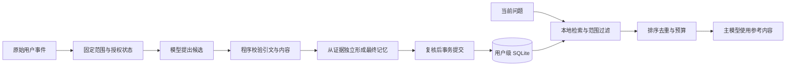

# Pico 长期记忆的设计与实现

用户告诉 Agent：“这个项目统一使用 pnpm，发布前先执行构建。”几天后，用户新建一个会话，继续处理同一个项目。如果 Agent 能在相关问题出现时读到这条约定，用户就不必重复说明背景。

Pico 的长期记忆围绕这种跨会话协作设计：从交互中保存值得复用的信息，记录它的来源和适用范围，再在需要时提供给模型。它使用用户级 SQLite 存储，写入由模型理解和程序校验共同完成，读取采用本地词法检索，并控制进入上下文的条数与 token 数。

这项功能的工程重点包括来源核验、并发修改、失败恢复和用户删除。模型调用可能持续几十秒，期间系统状态已经改变；一条历史事实也可能被用户更正。记忆从保存到使用，需要始终遵守这些变化。

## 三种信息保存机制的分工

Agent 的一次请求只能使用本次输入中的信息。Pico 的长期记忆保存在外部数据库中，相关内容通过后续请求重新提供给模型，这个过程不改变模型参数。

要理解它的职责，可以先区分三种机制。

| 机制       | 保存的内容                               | 解决的问题                   |
| ---------- | ---------------------------------------- | ---------------------------- |
| 会话历史   | 用户消息、助手消息、工具结果和执行事件   | 回看过程、恢复会话、核验来源 |
| 上下文压缩 | 一段历史的摘要及覆盖边界                 | 控制当前任务的模型输入长度   |
| 长期记忆   | 稳定偏好、项目背景、知识和用户保留的笔记 | 在不同会话中复用信息         |

会话历史保存在工作区事件库中，长期记忆保存在 `$PICO_HOME/memory.sqlite`。压缩改变后续模型读取历史的视图，原始事件仍然保留；压缩摘要也不会直接成为长期记忆。

例如，“项目使用 pnpm”可以同时出现在聊天记录和长期记忆中。两者生命周期独立：删除会话不会自动删除已提交的记忆，删除记忆也不会删除原始聊天及独立备份。

## 一条记忆包含哪些信息

一条长期记忆需要说明内容、适用范围和出处。Pico 将这些信息组织为 Memory Item，并另外保存检索 keys 和来源 sources。

| 信息               | 用途                                           |
| ------------------ | ---------------------------------------------- |
| 正文和内容类型     | 表达偏好、身份、项目背景、知识、失败经验或笔记 |
| 陈述类型           | 区分事实、计划和预测                           |
| 作用域             | 区分全局信息和某个工作区的信息                 |
| 来源               | 指向支持内容的会话、回合和原始事件             |
| 事件时间和观察时间 | 解释事实发生或有效的时间，以及证据的观察时间   |
| 检索 keys          | 帮助后续问题找到这条记忆                       |
| 版本和生命周期     | 支持并发更正、归档、恢复和删除                 |

“偏好简短回复”可能适用于多个项目；“本项目使用 pnpm”应限制在对应工作区。同一个 `PICO_HOME` 使用同一份用户记忆库，工作区记忆可以被这个项目的不同会话共享，全局记忆可以在该用户的受信工作区之间复用。

这里的用户级范围是本地应用的存储边界。多用户云服务还需要账户身份和权限体系，不能直接把本地目录隔离当成云端租户隔离。

时间信息也很重要。某个项目在月初处于准备阶段，月底已经进入发布阶段，这两条带日期的记录可以同时存在。最近修改时间用于排序和展示，不能替代事件发生时间，也不能证明一条旧事实现在仍然有效。

## 写入时怎样约束模型

Pico 有两类模型提取入口。普通正常完成的回合和自动压缩检查点可以触发后台处理；用户明确要求记住时，`memory_remember({})` 等待实际处理结果。`memory_extract({})` 登记提取意图，返回接受只表示请求已登记，保存结果还要看后续结算。

这些触发工具接受空对象，由 Host 捕获工作区、会话、原始事件和模型实际可见的输入。Host 是负责绑定运行上下文和工具权限的宿主层。随后，提取引擎处理固定范围内的证据。

常规事实提取只承认原始用户文本。候选引文必须能对应到原始事件，也要得到实际请求可见文本的支持。助手回复可以帮助解释“这个方案”等指代，但工具结果、隐藏控制消息和助手自己生成的结论不能直接成为正式用户证据。

第一阶段模型提出候选，程序检查结构、引文、时间和敏感内容。第二阶段从引文及必要语境独立形成最终记忆，不接收第一阶段生成的正文和 keys，减少第一阶段表述对最终内容的影响。最终结果还要再次校验，提交前复核准入状态。

必要时，引擎可以进行一次受限历史定位。每个处理段最多三次辅助模型调用，提取、定位、规范化和重试共同消耗这个额度，单次调用有 60 秒期限。一次触发可能处理多个段，因此三次是每段上限。

引文核验能约束来源，仍不能证明模型对语义的解释绝对正确。用户可以查看和更正已保存的内容，系统也保留其时间与来源供判断。

用户手动添加记忆，以及明确要求保存上一条助手回复时，还有本地校验后直接保存的路径。助手笔记绑定用户授权和紧邻的已完成助手原文，并标记未经独立核实；这两种保存路径不调用辅助模型。

## 召回时怎样找到有用内容

读取由统一的读取构建器 ContextBuilder 完成。自动注入、主动 `memory_search` 和记忆页查询预览都复用它，使用户看到的预览与实际读取规则保持一致。

检索首先规范化当前问题，提取完整英文词、路径和中文双字信号。英文按完整词核验，避免 `port` 因出现在 `report` 中而命中；中文正文至少需要两个不同的有效双字信号，减少单个常见片段造成的误匹配。

keys 的精确和前缀检索各取最多 100 个候选。正文检索扫描全部可见的活跃记忆，按词法相关性排序后加载最多 100 条匹配记录，弥补生成 keys 时漏掉查询词的问题。近期 500 条窗口只用于补充中文复合 keys 匹配，以及自动模式的一条通用偏好补位，旧笔记的正文召回不受这个窗口限制。

合并候选后，系统再次过滤工作区和归档状态，优先排列 key 命中，再按相关性、最近修改时间和稳定 ID 排序。最终返回还要经过去重与预算处理。

这里需要分清三个数量：记忆库保存多少条、检索发现多少候选、最终给模型多少条。十条限制作用于最后一步，记忆库可以继续增长。

当前去重只抑制特定类别下正文完全相同的无日期事实，而且只改变本次读取结果。带日期事件、计划、预测和助手笔记保留，数据库不会因此合并来源或删除记录。

这套检索是本地词法方案。同义改写、隐含关系和跨语言表达可能漏召回，是后续语义检索需要解决的问题。

## 如何确定召回预算

自动注入会占用主对话上下文，因此采用较小额度。主动搜索在自动参考不足时调用，可以提供更多内容。

| 入口     | 最大条数 | 整体预算          | 单条处理                                         |
| -------- | -------- | ----------------- | ------------------------------------------------ |
| 自动召回 | 3        | 320 tokens        | 普通长条目放不下时跳过，授权助手笔记可按锚点摘录 |
| 主动搜索 | 10       | 5120 tokens       | 每条连同元数据最多 480 tokens，可按原文摘录      |
| 查询预览 | 不超过 3 | 不超过 320 tokens | 使用自动模式，可以进一步缩小额度                 |

预算包括正文、来源和时间属性、XML 转义及低信任包装。十条记忆不能简单按每条平均 512 tokens 分配，因为外层说明也占用容量。

最初主动搜索整体限制为 1600 tokens。放宽到十条后，长记忆仍然受到总预算限制。在同一组十条长记忆构造样本中，只改变整体预算，结果如下。

| 整体预算    | 返回的长记忆摘录数 |
| ----------- | ------------------ |
| 1600 tokens | 3                  |
| 3200 tokens | 7                  |
| 4096 tokens | 9                  |
| 5120 tokens | 10                 |

十条短记忆在该容量对照中只占约 869 tokens。实际用量取决于内容长度。5120 的设计依据是容纳十条各不超过 480 tokens 的引用，并为外层包装留出余量。

这也不意味着完整载入十条长笔记。长正文在能够定位查询锚点时，保留关键词附近的原文摘录，并记录 Unicode code-point 的起止区间，便于回到原文核对。读取阶段不调用模型生成新摘要。

调用方要求更小预算时，系统逐条尝试完整内容或摘录；连最小摘录也放不下，就跳过，再尝试后面的候选。发生摘录、超预算遗漏或条数限制时，输出标记 `truncated=true`。数据库原文仍然完整保留。

## 并发修改和失败恢复

记忆提取包括外部模型调用和本地数据库更新，需要同时处理两个执行环境的失败。

Pico 使用操作 ID 和业务请求哈希识别重复执行，通过同一事务提交记忆正文、keys、来源、处理游标和回执。如果提交过程中中断，不会出现记忆已经保存而对应游标未提交的半完成状态。

同一操作重放可复用首次回执。回执描述那次操作的结果；用户后来更正了内容时，当前条目应通过读取接口获取，历史回执不会自动变成当前条目的最新视图。不同操作仍可以保存相同正文，读取时的去重与操作幂等分别解决不同问题。

进程内按会话串行处理提取，跨数据库连接的一致性依靠版本和游标 CAS。CAS 的含义是：只有存储中的版本仍与读取时一致，更新才允许提交，避免旧操作覆盖新状态。

内存队列不持久化。后续触发依据已保存的失败范围、游标和完成或压缩边界恢复处理。再次重试失败时，可以放弃该范围并推进进度，避免某段历史永久阻塞后续记忆；这不是保证所有历史最终都会成功写入的后台任务系统。

### 删除时仍在运行的提取

一个实际问题是：模型还在生成，用户已经删除了记忆。

如果后台任务只看自己开始时的输入，它返回后可能把被删除的信息重新保存。Pico 使用删除代次处理这个交错：

1. 提取快照记录当前代次 `n`。
2. 用户删除后，数据库代次变为 `n + 1`。
3. 旧任务提交时发现代次不匹配，旧范围失效，不能重新写回内容。

压缩检查点也要保存自己的设置版本、准入和删除代次。恢复历史范围时，同时检查冻结信息与当前策略，不能拿新的授权状态重新放行已经失效的旧范围。

当前删除代次覆盖整个用户记忆库，一次删除会使其他在途旧代次提取也失效。这是一个保守取舍，简化了对旧任务重新写入的约束。用户后来再次明确要求保存，新的请求可以使用当前代次处理。

## 来源和安全边界

记忆输入统一标为低信任参考。历史事实可以帮助回答问题，当前用户要求仍然优先；记忆里的命令句不能授予工具权限、改变工作区信任或修改 Provider 和凭据配置。实际工具授权由 Host 控制。

读取策略区分总开关、自动提取开关和召回开关。关闭自动提取仍可响应新的显式记住请求，关闭召回仍可管理已有条目。主动搜索执行前后复核信任及读取开关，工作区由 Host 绑定，模型不能在工具参数里指定另一个工作区。

内容检查还需要覆盖字符转换后的形式。曾出现的边界问题是：敏感文本被零宽字符拆开，原文扫描没有匹配；持久化规范化移除这些字符后，又形成了敏感字符串。

修复后，正文、keys 和引文同时检查原始与持久化形式，并在模型提取和规范化阶段校验。这样的检查能降低已知敏感模式的泄漏风险，任意敏感信息仍需要更完整的识别策略。

用户可显式更正、归档、恢复和删除条目。更正使用版本校验，重建 keys 并清除旧来源，避免修改后的正文继续错误关联原证据；观察时间保留，最近修改时间更新。归档停止召回并保留内容，删除则清理记忆及相关回执中的正文。

## 如何验证效果与成本

验证需要分别观察工程约束和模型行为。

SQLite 集成测试检查范围隔离、归档过滤、原文摘录位置、token 上限、版本校验和只读性。真实模型测试检查模型是否实际调用搜索、收到哪些记忆，以及最终回答是否依赖正确证据。

在 2026 年 10 月 8 日这轮预算调整的最终状态上，三个相关集成文件共 22 项检查通过，三个真实模型用例通过。真实模型用例覆盖长笔记靠后标识、一次搜索组合六条长记忆中的独立配置，以及按日期区分项目状态；用例还检查辅助提取调用为零、记忆条目没有被读取过程改写。

本地性能基准使用一万条记忆，每条 2000 code points，预热十次后执行一百次指定标识查询。最终状态的一次运行中，完整本地读取链路 P95 约 160ms，满足 200ms 门槛。这个结果描述该机器和查询分布下的候选发现、排序、摘录与 token 处理耗时，不包含主模型回答的网络时间，也不能代表所有宽泛查询。

这些结果证明已覆盖场景中的行为，尚不能给出普遍的记忆准确率。评估实际收益还需要真实任务样本：关键记忆是否遗漏、无关内容是否增加、回答是否正确，以及上下文成本是否值得。

成本观测同样要分口径。提取回执记录成功结算段的创建数、模型调用数和耗时；实际模型账本记录物理请求及费用，包括可能收费的失败调用。回执创建数是历史创建量，删除记忆不会让这次创建从历史统计中消失。手动添加和本地保存助手笔记不调用辅助模型，也不进入模型提取回执统计。

## 当前能力与后续演进

Pico 已具备提取、持久化、跨会话召回、原文追溯、用户更正和提取观测的完整使用流程。它仍主要依靠词法检索，尚未实现通用语义去重、自动冲突裁决，以及完整的任务成败经验学习机制。存在失败经验这个内容类型，也不等于系统会自动从每个失败任务中学会新的工程方法。

下一步应从真实使用样本决定方向。如果主要问题是词法检索规模，可以评估全文索引；如果主要问题是同义改写遗漏，可以评估语义或混合检索；如果主要问题是信息过期和矛盾，则需要完善时间、来源和更正策略。

每种改进都应同时观察关键事实召回、无关内容、任务成功率、延迟与成本，并继续复用来源校验、作用域过滤、事务和预算控制。

实现细节见[长期记忆架构](architecture/14-workspace-memory.md)与[记忆技术指南](pico-memory-technical-guide.md)。对应代码入口包括[提取引擎](../packages/runtime/src/atomic-memory/extraction-engine.ts)、[读取构建器](../packages/runtime/src/atomic-memory/context-builder.ts)和[SQLite 存储](../packages/storage/src/sqlite/sqlite-memory-item-store.ts)；模型行为用例见[真实模型搜索测试](../tests/e2e/atomic-memory-search.real-llm.test.ts)。
