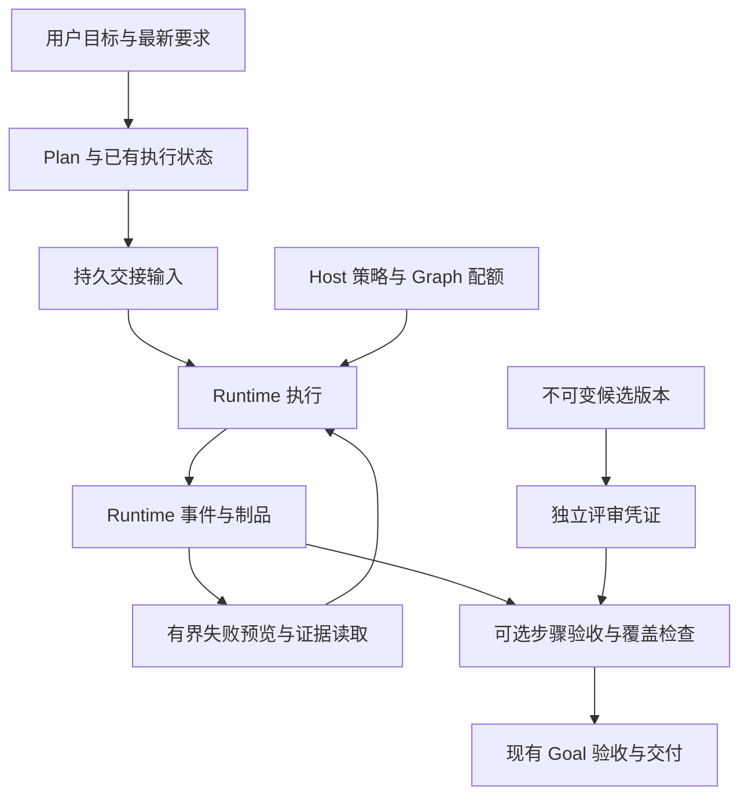

# Pico Harness 课程借鉴与整体实施方案

Pico 的下一步应优先提高长任务的可靠性：失败后能看到关键诊断，重规划能接到此前的状态与最新要求，需要验证的步骤有真实依据，多代理任务在资源上限内执行，汇总结果能说明覆盖范围和分歧。沿现有 Runtime、Plan、Goal、AgentGraph 和存储实现逐项补强，每项独立验收和交付。

实施分三批：第一批完成长失败预览和重规划交接；第二批增加 Graph 配额和可选步骤验收；第三批在明确的多代理研究、代码评审场景中增加覆盖契约和版本化评审凭证。失败经验与技能晋升保留为条件触发的后续试点。

基线日期为 2026 年 10 月 9 日。课程范围是当前已下载的 47 篇文章，共 929 页，包括 01 至 42 讲、开篇词、直播文章和三篇加餐；这不代表尚在更新的课程已经完结。以下数据字段和默认值属于拟实施设计。

## 目标与现有基础

这次改进围绕四类实际任务展开：长日志排障、执行中断后的重新规划、有明确检查要求的编码任务，以及多个子代理共同完成的研究或评审任务。短问答、简单文件修改继续走现有直接执行路径。

| 能力         | 当前基础                                                             | 本次增量                                     |
| ------------ | -------------------------------------------------------------------- | -------------------------------------------- |
| 工具结果     | 正常准入结果保留正文与完整性信息，后续读取侧生成归档预览             | 失败预览保留尾部诊断及已有恢复指引           |
| 上下文与记忆 | 结构化压缩、分层工作集、来源核验、真实请求关联的 Memory Recall Trace | 复用这些能力承载交接，不重建记忆服务         |
| Plan         | 持久事件、版本、控制身份、幂等操作、中断与恢复                       | 显式投递重规划上下文；为指定步骤增加可选验收 |
| Goal         | 独立只读验收、本 Run 冻结证据、原生过程事实与修改后验证检查          | 保持现有目标验收，提取可复用的纯证据校验规则 |
| AgentGraph   | 精确 activation 身份、输出账本、制品引用、持久唤醒、进程恢复         | 增加跨 revision 的配额及声明式覆盖检查       |
| Review       | 只读评审角色、包含工作区差异的 Git revision 身份                     | 将评审结果绑定实际读取的候选版本             |
| 权限与预算   | 最终参数重新授权、一次性审批、请求输入预算、各 Engine 执行预算       | 配额与凭证不能改变权限；不另建审批系统       |

当前代码已经实现真实记忆召回追踪和 Goal 执行证据验收。[召回请求关联][memory-trace]、[Goal 验收][goal-evaluator]应作为基线；早期调研中关于这两项尚未接通的结论不再作为待办。

## 课程模式的采用边界

| 课程范围                    | 在 Pico 中的安排                                   |
| --------------------------- | -------------------------------------------------- |
| 01 至 05 模式分析与工程选型 | 用代表性任务验证增量收益，沿当前结构逐项交付       |
| 06 至 10 感知与上下文       | 优先长失败预览，保留渐进读取和既有请求预算         |
| 11 至 15 记忆与进度         | 优先交接保真，复用召回追踪；失败经验按复发场景试点 |
| 16 至 20 推理与假设验证     | 将假设和真实证据分开，借助有界排障任务验证效果     |
| 21 至 25 行动与执行准入     | 补重规划送达、步骤验收，复用现有权限及恢复边界     |
| 26 至 30 反思与能力复用     | 明确评审对象版本，经验和技能须经验证后复用         |
| 31 至 35 协作               | 用固定责任、来源身份、覆盖结果和分歧说明约束委派   |
| 36 至 42 治理与模式组合     | 配额落到执行准入，评估组合后的质量、成本和接手情况 |

Loop Engineering 的循环与退出约束用于完善现有 Engine 的恢复验收；dsh 的组合、执行和记录分工用于检查现有能力装配边界；Jev 的候选评价思路保留为需要时的评估试验。三个加餐均不要求替换 Pico 的 Provider 或插件架构。[Loop Engineering][课Loop]、[dsh][课dsh]、[Jev][课Jev]。

## 架构与事实归属

执行事实继续保存在 Runtime 账本和现有制品存储中；Plan 保存计划控制状态；Graph 控制存储保存调度、配额与输出身份。交接包、预览和验收凭证都是带来源的投影或派生事实，不成为另一套可以独立修改的任务状态。

| 内容                     | 唯一事实所有者                  | 写入规则                                             |
| ------------------------ | ------------------------------- | ---------------------------------------------------- |
| 工具输出、开始与结束事实 | Runtime 事件存储                | 保持原始身份与完整性语义，预览不能改正文             |
| 计划及步骤状态           | PlanCoordinator 与 Plan reducer | 持续使用既有操作身份、版本和 CAS                     |
| 重规划交接               | 对应重规划操作的持久输入        | 一次冻结，一次幂等投递，重试读取同一内容             |
| Graph 配额策略与预留     | Graph 控制存储                  | Host 决定上限，首次 claim 在同一事务内扣占           |
| 子代理输出与来源身份     | Graph 输出账本及资源 authority  | 复用 RecordRef 和已提交 artifact URI                 |
| 验收与评审凭证           | 对应控制操作的持久记录          | 绑定条件、候选版本及真实证据，不能由模型直接签发通过 |

贯穿所有改动的约束如下：

- 已入库正文、事件身份和历史凭证保持可回看；不得因预览或策略升级改写旧事实。
- 模型声明完成、工具成功退出、业务条件满足分别处理。某条任意命令退出码为零，不能证明指定条件成立。
- 操作重放使用同一持久身份，不重复开 Run、不重复扣配额、不重复签发结果。
- 中断、未知状态和未收口工具不能被推断为成功；高风险边界由宿主机械校验。
- 当前用户要求可以改变目标。旧计划的 completed 状态不能自动证明新要求已满足。
- 新机制只在适用场景启用，不改变已有审批、工作区信任与记忆准入规则。

## 第一批 长失败预览

### 问题与改动范围

当前较大的活跃工具结果会进入归档投影，通用预览只保留开头 500 字符。已在本地确定性复现：长失败输出尾部的错误和修复提示没有出现在下一次模型可见预览中，原文与归档地址仍然存在。这证明了投影缺口；是否影响模型修复质量，需要真实模型场景验证。[投影策略][tool-projections]、[归档预览][tool-archive]。

普通失败的 Recovery 指引保存在 `projection.text`，与物理输出正文分开；`data.recovery` 则是恢复合成结果的标记，现有归档例外会保护它。因此新的失败预览必须读取当时完整的投影，不能只从正文重新生成。[写入投影][tool-observation]。课程第 07 讲和第 08 讲提供了按信息用途分诊、保留影响下一步行动的内容这一原则。[第07讲][课07]、[第08讲 p5][课08]。

### 实施设计

在现有归档函数中先为普通 `failed` 结果增加确定性的诊断预览，不调用额外模型：

1. 明示工具名和失败状态，保留开头、尾部及有限的错误附近片段；片段去重并标注截断。
2. 从完整投影中保留已有 Recovery 指引。物理输出片段可标明原文位置；仅在投影中存在的指引标为恢复提示，不能伪标成归档正文的行号。
3. 保持原始正文、hash、bytes 及 archive URI 不变，中部遗漏可继续用既有 archive 工具定位。
4. 短失败保持全文；成功结果沿用现有策略；合成恢复结果、归档回读以及 1 MiB 入口上限沿用现有边界。

建议失败预览初始硬上限为 4096 字符和 1024 tokens，包含提示和归档地址，取更严格的限制，优先分配给尾部诊断。具体分段长度作为模块内常量，通过夹具校准；不能因为错误匹配很多而放宽总上限。保持已有 `failure_resolved` 等替代规则，避免所有历史失败永久占据工作集。

不改事件 schema、归档 URI 或 reason 枚举。投影仍先通过现有转换提交门持久化，再用于模型请求；转换写入失败时使用原投影。历史投影按保存内容回放，升级不重算既有投影。

### 验收与回退

扩展[持久工具投影集成测试][test-tool-projections]：失败尾部的错误码、路径和实际 RecoveryManager 提示进入下一次模型历史；预览有界；原文及完整归档读取不变。冷恢复文本一致，重复 prepare 不多写转换。中部诊断夹具确认选中片段位置准确，投影附加提示不会被错当原文；关键失败路径确认转换写入失败时不会提前使用新预览。

真实模型验证使用长日志排障任务，检查模型是否依据实际诊断采取正确的下一步；提示出现本身不等于模型正确使用。回退仅切换新结果的预览生成策略，保留已写入事实和旧策略的读取能力。

## 第一批 重规划持久交接

### 问题与改动范围

当前重规划保留原会话，提交 `plan.execution.replanned` 并切换到 Plan Mode，随后向执行入口传入反馈。产品恢复路径使用 `resumeExistingSession`，会跳过普通新用户消息写入；重规划没有已批准计划路径使用的 `planExecutionPromptId`。因此需要验收反馈与旧状态是否实际进入 Provider 请求，不能仅检查函数收到了 `prompt`。[重规划入口][replan-runtime]、[控制消息投递][run-executor]。

已有 revision request 会在 Run admission 时通过 `commitMessageOnce` 投递持久控制消息，可以复用这一方式。但 revision request 面向待批准 proposal，重规划面向中断执行，两者不能直接互换。保留重规划生成新计划的现有行为，不顺手改成同一个 planId 的修订。[已有修订输入][revision-input]。课程第 23 讲和第 35 讲强调恢复应接住状态、责任与证据。[第23讲 p10 至 p11][课23]、[第35讲][课35]。

### 实施设计

在现有 Plan 控制链中冻结一个有界交接包，并接入实际模型读取路径：

| 交接内容                                                    | 语义                                                       |
| ----------------------------------------------------------- | ---------------------------------------------------------- |
| 旧 planId、revision、controlEpoch、冻结来源水位与源事件身份 | 标明交接来自哪次执行，禁止混用另一版本                     |
| 各步骤状态与短 note                                         | completed、skipped、进行中和未开始分别保留；状态是控制事实 |
| 中断原因与最新反馈                                          | 保留反馈来源，并明确新要求改变了哪些目标或约束             |
| 已有验证和制品引用                                          | 仅引用已存在事实；缺失时明确未提供证据，不生成推测证明     |
| 待核实事项与原计划读取入口                                  | 压缩不下的材料可按来源回读，不静默省略关键范围             |

交接初始上限建议为 8 KiB，并同时遵守已有 Plan 事件总大小上限。优先保留最新要求、中断原因、步骤身份和状态；长 note 与证据正文使用短引用。最新反馈放在明确的用户要求部分，工具日志与模型笔记保持参考数据边界，不能借交接获得指令权威。

在 `plan.execution.replanned` 中增加可选且版本化的 `replanContext`，与取消旧执行、切换 Plan Mode 在同一操作中提交。它保存最新反馈及冻结来源，旧目标、步骤和 note 从对应水位的账本重建。交接与重规划操作绑定持久身份，幂等指纹覆盖影响交接的反馈和旧版本，渲染规则也带版本。

PlanProjection 派生待处理交接，Run admission 从已提交事实读取，以稳定消息 ID 投递内部控制消息；不要依赖进程内闭包，也不要借用执行授权消息。当前任务锚点会排除隐藏控制消息，因此待处理交接还须通过 Host turn tail 或受限的 Host 锚点恢复，保证压缩后仍可见。新计划成功提交后消费交接，不持续注入旧执行要求。

明确处理“重规划转换已提交、控制消息或 Run 尚未完成准入”的崩溃窗口：仅在可信 Host 恢复原持久 intent、且交接仍待处理时继续规划。恢复同一 daemon/workspace Run intent 身份，补齐缺失输入；底层 RuntimeRun 续跑遵守既有恢复规则，不笼统要求所有历史只有一条 run.started。普通重复操作及新计划提交后的重放返回原结果，不隐式重新调用模型。新计划仍按现有流程等待用户批准，交接不构成执行授权。

### 验收与回退

主路径夹具为 A 步骤 completed、B 步骤 in_progress、execution interrupted，用户要求改变后续实现。检查实际 Provider 请求包含旧版本、两步状态、中断原因和最新反馈；模型自述的状态与真实验证引用有区分。使用[Host admission][test-plan-admission]和[Plan Runtime 恢复][test-plan-runtime]的主链夹具验证送达。

恢复测试覆盖转换提交后、控制消息提交前及消息提交后的故障：恢复同一 workspace intent 身份，交接内容一致，只存在一个控制消息及一个新计划 proposal；反馈变化不能被当成同一操作的合法重放。新计划已提交后重放不再调用模型，首请求前触发压缩时交接仍可见。真实模型场景检查是否正确调整未完成工作，同时按新要求重新核实受影响的已完成部分。

回退可停止生成新交接包，但保留已存包的读取和恢复逻辑。持久操作与输入兼容必须在关闭写入后仍然成立。

## 第二批 Graph 并发与累计配额

### 问题与改动范围

Graph 已有限制：每次最多 32 条调度命令、引用及 JSON 大小上限，同一 operator 的活动任务有占用检查，各 Engine 有自己的执行预算。需要补的是同一个 Graph 跨 revision、唤醒和重试的总并发与累计 activation 上限。[调度执行][graph-reconciler]。课程第 38 讲和第 42 讲要求把组合后的资源边界写进执行系统。[第38讲 p4 至 p8][课38]、[第42讲 p6][课42]。

该配额约束同一 Graph epoch 下的子代理 activation。Root 和直接配置的子代理继续使用原有预算；它不等价于跨所有 Graph 的总 token 或费用钱包。当前 operator provision 先于 claim，首期也不承诺限制预创建 worktree 的数量。

### 实施设计

Host 在创建 Graph 时冻结策略，至少包含 `policyVersion`、`maxConcurrentActivations`、`maxTotalActivations`。模型可读取当前用量和排队原因，不能提高上限。试点可从并发 4、累计 32 开始；正式默认值根据代表性任务的实际分布校准，测试使用更小阈值验证规则。

配额落在现有 SQLite Graph 控制存储。第一次合法 claim 在同一写事务中检查策略、建立 claimId 唯一的 reservation、保存 claim，并计入累计量；重放先命中已有身份，不能再次计数。[claim 存储事务][graph-store]。

| 情况                                | 处理                                                             |
| ----------------------------------- | ---------------------------------------------------------------- |
| 并发已满                            | 保留 intent 排队，按确定顺序等待，不启动物理运行、不制造循环错误 |
| 累计已耗尽                          | 阻止新增 claim，给出明确 attention 原因；已有运行正常收口        |
| 相同 claim 重放                     | 返回已有事实，不重复占位与累计计数                               |
| activation 正常终止                 | 根据精确 Run terminal 身份幂等释放并发占位                       |
| 已确认未派发且已 fencing 的取消     | 持久保存该证明后释放并发占位                                     |
| 有输出但 Run 未终止，或运行状态未知 | 继续占位，走已有恢复流程                                         |

累计量按首次获准 claim 保守计数，取消不返还；它表示已承诺的 activation 数量，另可观测实际启动数量。初版可从唯一 reservation 行数计算，避免额外维护缓存计数器。同一 Graph 的新 revision、operator generation、Root 唤醒都不重置累计量。

不能直接按 claim 的 `executing` 状态计数：现有 claim 没有正常完成终态；也不能见到 `agent.output` 就释放。Runtime 的 `interrupted` 投影可能来自宿主存活判断，未必有持久 terminal 事件，释放必须核验真实结束或未派发证明。[运行状态投影][activation-projection]。未知状态先恢复与收口，避免提前释放造成超限。

结算扫描必须覆盖 cancelled claims，处理取消后晚到的真实 terminal。物理启动边界同时核验 reservation fence，防止检查通过后等待、期间占位被取消释放、旧调用又启动的竞态。累计耗尽只禁止 fresh claim，读取、stop、finish 和已有运行的收口仍可执行。

### 验收与回退

三条 ready intent、并发上限二：只启动两条，一条真实终止后第三条才能启动。两个 reconciler 并发 claim 不得突破上限；重复 claim 和 terminal 观察不得重复扣占或释放。

恢复测试覆盖 claim 提交后崩溃、已启动未收口、取消但派发结果未知、terminal 已提交但尚未结算等窗口，特别检查 cancelled 后 terminal 晚到，以及有输出但无 terminal。跨 revision 达到累计上限后不得新增 claim，但仍能读取和封闭 Graph；重启不重置用量。扩展[Graph reconciler 测试][test-graph-reconciler]与[进程恢复测试][test-graph-recovery]。

旧 Graph 保持原有策略，不能中途臆造零使用量。新策略只在新 Graph 启用；如以后需要升级存量 Graph，应另做基于既有 claims 的对账。回退关闭新策略写入，继续尊重已冻结策略；有活动预留的 Graph 不得交给不理解配额的旧二进制。

## 第二批 可选 Plan 步骤验收

### 问题与改动范围

当前 PlanStep 保存状态和 note；步骤全部 completed 或 skipped 后关闭执行。这是控制流程语义，skipped 不是完成判定缺陷。需要验证的步骤，可以额外要求提供与条件对应的真实证据。[Plan 契约][plan-contract]。课程第 24 讲的段间契约可用于阻止未经核实的结果传到后续阶段。[第24讲 p11 至 p13][课24]。

### 实施设计

在已批准 proposal 的指定步骤上增加可选 acceptance 条件；普通 checklist 不增加验收调用或强制证据。第一版限定为 `process_success`，声明实际需要成功执行的命令，宿主核对已授权的最终工具参数及原生结果。暂不增加自由文本条件的额外模型验收。

验收凭证绑定 `planId`、`revision`、`stepId`、条件摘要、冻结水位及证据身份。模型通过 `update_plan` 提交引用，由宿主解析真实事件和制品，验证归属、正常收口、原生过程事实、条件相关性及修改后的时序，再决定是否接受 completed。失败时保持步骤未完成，并返回可处理原因。

以下三条边界必须单独设计：

1. Goal 的证据上下文要求 completed 的 `run.terminal`；步骤更新发生在活跃 Run 中，不能直接调用整套 Goal 验收或伪造 terminal。只复用纯校验规则，为步骤建立独立的 active checkpoint 边界。[Goal 证据边界][goal-evidence]。
2. 当前 `update_plan` 自身工具调用尚未收口，通用查询还可能把它视为潜在修改。步骤验收只排除当前这条已识别的宿主控制调用，其他真实工具仍须正常收口。校验结束到状态提交之间使用严格水位 CAS；非 Plan 的工具事件前移也必须重新验收，不能沿用普通 Plan 提交时容忍非 Plan 事件的重试行为。[Plan 提交][plan-coordinator]。
3. 同一 Provider 回复中尚未 dispatch 的后续写调用不会出现在 tool.started 查询中。带 acceptance 的完成请求必须独占该 Step，或使用专门的独占完成入口，避免完成后才执行同批写操作；普通 checklist 不改变执行方式。

新 acceptance 随 proposal 一起批准，进入 normalization、内容比较及指纹；修订条件需要正常计划修订。凭证与完成事件原子提交，身份可复用事件封套，避免另建状态表。跳过步骤继续表示调整控制范围，不生成验收通过凭证。第一版只接受当前 Run 的候选证据，重启后的未完成步骤重新检查；既有凭证保留为当时检查点的事实，不能证明后续修改后的最终工作区仍然通过。

### 验收与回退

成功夹具提供相关修改之后的指定检查成功事实；关键失败夹具让助手声称检查通过，但真实命令失败或发生在最终修改之前，completed 必须被拒绝。检查无 acceptance 的旧计划行为保持一致。

增加校验后又发生相关修改的竞态，证明必须重新验收；同批后续写调用不能与带验收的完成请求一起放行。恢复后旧凭证不能证明新 revision 或新候选。真实模型 E2E 检查是否提交正确检查证据并按失败原因继续处理；将来扩展模型判断条件时再单独验证语义相关性。

先停止生成新 acceptance 即可回退新任务行为。已批准带条件的计划仍须执行原合同；旧二进制若不理解合同应明确拒绝执行，不能静默丢弃条件。

## 第三批 多代理覆盖与分歧保留

### 场景与改动范围

先选择固定分工的研究场景，例如按源码模块或课程章节分配阅读范围。Graph 的 finish 已验证选中 RecordRef 存在且属于本 Graph，但不会证明声明的业务范围已经覆盖。[Graph finish][graph-finish]。课程第 32 讲、第 33 讲强调责任可验收、汇总保留缺失和差异。[第32讲 p9 至 p10][课32]、[第33讲 p12 至 p15][课33]。

### 实施设计

Root 提交覆盖契约时声明稳定的 responsibility ID、必须覆盖范围、允许缺失的结果模式及 contract version。以冻结责任身份映射实际 operator/activation 输出，避免让模型用任意标签伪造完成范围。

汇总制品包含已收到范围、缺失范围、重复范围、未解决分歧以及对应 source RecordRef。source 相同的三个输出不能当作三份独立证据；可观测独立性只按实际来源解释。

契约启用后，finish 显式区分 `outcome=complete` 和 `outcome=incomplete`。前者要求所有必须范围被有效覆盖，并且声明的 blocker 已处理；后者允许封闭 Graph，同时持久保存缺失、分歧和原因，交给已有 Goal 或 attention 路径处理。finish 仍是生命周期收口，不能让缺片或配额耗尽的任务永久无法结束。额度不足时由 Host 依据现有记录生成 incomplete 结果，不要求再启动汇总代理。

完整性检查由宿主根据契约完成，语义正确性仍交给已有 Goal 验收。缺失和重复由 Host 从正式记录计算，不信模型自填的通过字段；第一版不承诺自动发现所有矛盾。合法失败重派通过既有替换身份更新责任生产者映射及版本，不能删除缺片来获得完整状态。

复用现有输出账本和 artifact URI。`agent_output.evidence_refs` 已退役，不恢复该字段；来源与读取结果写入 output，有界结构化报告可放入 output，较大报告使用已提交的 artifact 引用。[Graph 资源 authority][graph-authority]。

Host finish preflight 读取正式输出和不可变制品，检查 Graph 归属、生产者身份、成功状态、契约版本及覆盖，生成宿主凭证。Graph 控制存储在 finish 的 CAS 事务中重核 headRevision、契约版本和 selected refs，并原子保存凭证；不能只加到提示词里。

### 验收与回退

选中记录合法但缺少一个必须范围时，完整交付不能通过；补齐有效输出后可完成。重复范围不能替代缺失范围。两路结论冲突时，汇总必须保留分歧和来源，不能自动用多数票消除。

契约更新或重派后，旧版本及旧生产者汇总不能完成新要求；验证与 finish 提交之间发生版本变化时拒绝旧凭证。incomplete 必须能正常封闭，重放及崩溃恢复读取同一结果。真实模型场景检查 Root 是否能正确表达缺失和冲突，并按需补派任务。新场景默认先受第二批 Graph 配额约束，汇总代理也正常消耗额度。

无覆盖契约的 Graph 保持原 finish 语义；已声明硬契约的 Graph 在回退后仍需按合同结束或显式取消。

## 第三批 绑定候选版本的评审凭证

### 场景与改动范围

只在明确要求独立评审的代码任务中启用。现有 Git revision 覆盖 HEAD、暂存与未暂存差异、未跟踪文件内容，并可拒绝读取过时 diff；这提供了候选身份，但不等于模型已经审过这个版本。[工作区版本身份][git-review]。Graph 的输出 success 也不能直接当作评审通过。课程第 27 讲、第 34 讲提供了版本独立审查和阻断性异议的设计。[第27讲 p13 至 p14][课27]、[第34讲 p10 至 p11][课34]。

### 实施设计

评审凭证至少绑定候选 revision、review Run、只读 profile 版本、实际读取材料的摘要、结论与 blocker 来源。宿主仅在输入身份与读取范围可核验时保存凭证。

第一版只支持明确选择的 staged 或 unstaged 评审范围。Host 将实际差异、固定基线及所需上下文保存为不可变候选制品，制品 digest 是实际审查对象的身份，workbar revision 用于关联工作区及判断当前适用性。只在开始和结束比较 revision，不能证明中途读取的实时文件属于同一版本；没有固定输入时只能保存评审意见，不能签发版本验收凭证。读取可变工作区的附加观察单独保留，不能替固定候选签发通过。

完成交付前重新核对当前候选身份。V1 凭证保留为历史；代码变成 V2 后，V1 不再证明当前结果通过。异步评审返回旧版本时，不把它挂到最新候选。评审角色沿用现有只读能力，不获得实现或发布权限。

凭证证明审过哪份材料和得出什么结论，不能保证模型发现了所有缺陷。声明为 blocker 的独立异议必须有版本、来源及处理结论；是否允许带未解决事项交付由当前任务合同决定。

### 验收与回退

V1 完成评审后修改为 V2，交付必须提示凭证过时；重新评审 V2 后才能满足合同。增加异步旧评审回写场景，确认不能替代新版本凭证。输入未冻结或读取范围不足时不能签发通过凭证。

默认代码任务不强制引入额外评审。回退关闭新任务的凭证要求，保留已有意见、来源和版本；已声明评审合同的任务仍须完成或显式调整合同。

## 条件触发的失败经验与技能复用

只有某类失败反复出现且补救方式被验证后，才启动一个任务族、一个 workspace 的试点。候选经验记录症状、已证实事实、根因假设、适用条件、已验证补救和事件来源，经过现有准入与确认后再参与长期召回。[第15讲][课15]、[第29讲][课29]。

使用现有记忆预算，先验证同类任务行动前能取回短经验、无关任务不会收到，评价重复失败、误提醒及过时使用。不得为了试点放宽用户事实提取规则，成功对话也不能直接变成受信 Skill。

团队共享技能确有需求时，再绑定 Skill 内容摘要、环境条件和测试集版本，验证它在目标任务上有效。[第28讲][课28]。已有来源 hash 只能证明读了哪份文件，不能单独证明能力。记忆有效期、自动复杂度路由、全局费用钱包、外部知识库、插件架构迁移分别需要实际需求触发，不纳入本次三批实施。

## 实施顺序与并行边界

| 批次     | 交付项             | 依赖与完成条件                                               |
| -------- | ------------------ | ------------------------------------------------------------ |
| 第一批 A | 长失败预览         | 可独立实现；投影回归通过，真实模型排障主路径通过             |
| 第一批 B | 重规划交接         | 可与 A 并行；实际请求输入、幂等及崩溃窗口通过                |
| 第二批 C | Graph 配额         | 单独处理持久化与并发；并发竞争、恢复及累计上限通过           |
| 第二批 D | 可选步骤验收       | 与 C 业务独立；先冻结 active checkpoint 契约，再实现状态提交 |
| 第三批 E | 覆盖与分歧契约     | 先有明确分工场景；使用 C 控制资源，契约与真实汇总验证通过    |
| 第三批 F | 版本化评审凭证     | 先有固定候选读取能力；可独立试点，再接 D 或 E 的验收合同     |
| 后续试点 | 失败经验与技能复用 | 出现可重复、已验证的问题，且前三批提供所需来源与版本能力     |

A 与 B 的文件边界清晰，可由两个子代理在独立 worktree 中实现。C 与 D 会分别涉及 Graph 和 Plan 的公共契约及 SQLite 模块，由主代理先串行冻结接口、迁移和生成物，再划分无共享写入的实现范围。E 与 F 的公共凭证引用由单一所有者处理，不能同时改同一 schema。

每项形成独立变更；子代理只更新自己的任务分支，主代理在干净的集成分支合并和验证。原工作区已有修改保持原样，不自动 stash、暂存或提交。实施范围达到该项验收条件即停止，不因一次课程调研开启持续扩建。

## 验证与效果评估

确定性行为使用现有集成测试，模型使用效果放在真实模型 E2E 中。增加测试以行为边界为对象，优先一条成功主路径和一条关键失败路径；持久化与并发项额外覆盖必要的恢复及竞争窗口。

| 验证对象   | 现有测试落点                                                                              | 需要新增的重点                                    |
| ---------- | ----------------------------------------------------------------------------------------- | ------------------------------------------------- |
| 失败投影   | [durable tool projections][test-tool-projections]、[archive 真实模型][e2e-archive]        | 尾部诊断、投影附加指引、完整回读与排障行为        |
| 重规划     | [Plan 状态机][test-plan]、[Plan 真实模型][e2e-plan]                                       | 实际 Provider 输入、一次投递和恢复窗口            |
| Graph 配额 | [reconciler][test-graph-reconciler]、[进程恢复][test-graph-recovery]                      | 并发竞争、唯一计数、未知派发和终止释放            |
| 步骤验收   | [Plan 状态机][test-plan]、[Goal 证据夹具][test-goal]                                      | active checkpoint、条件对应、修改后验证和严格 CAS |
| 汇总与评审 | [Graph core][test-graph-core]、[Git review][test-git-review]、[Graph 真实模型][e2e-graph] | 缺失范围、分歧保留、候选变化及旧凭证拒绝          |

对改动前后使用同一组任务、仓库快照、Provider 和模型配置。第一轮每个目标场景做三次配对运行，保留样本数与原始结果，不用小样本宣称统计成功率提升。记录以下结果：

- 是否完成用户条件，是否错误宣称完成，以及是否引用了过时或不相关证据。
- 排障中的重复失败动作，重规划中的不必要重复实施，以及遗漏的要求。
- 汇总漏项、被省略的分歧、过时评审凭证和资源超限。
- 实际工具调用、token、耗时、重试和人工接手，用于评估新增机制的代价。

机械不变量必须全部通过。真实模型主路径必须达到预先写明的任务验收；出现新机制导致的失败或明显额外成本时，先缩小启用场景或修正实现，再扩大使用范围。单次 E2E 通过只证明该场景可运行，长期收益通过后续真实任务数据判断。[第40讲][课40]、[第41讲][课41]、[第42讲][课42]。

代码验证先运行该项相关的集成文件；跨 core、storage、runtime、host 契约时追加受影响包的类型检查和构建。真实模型验证只选择对应场景，不默认运行全部 E2E。文档阶段不把上述拟验收项目记为已通过。

## 持久化兼容与上线

新事件字段采用显式版本和可选字段，旧事件继续可读；旧计划、旧 Graph 的语义不能因缺字段被猜成已验证或零用量。具体存储变更沿用现有 schema 升级方式，迁移、序列化、恢复与协议字段由单一所有者维护。

新 writer 启用前，reader 和恢复逻辑先具备识别新事实的能力。是否能回退旧二进制需要按合同逐项判断：预览可恢复旧生成方式；配额与验收合同一旦承诺给活动任务，就不能通过降级让其失效。没有兼容能力的旧版本应拒绝相应活动任务，或等任务收口后再降级。

上线按明确任务类型试点，通过上述验收后才扩大启用范围。每批保留独立停用入口，关闭新写入后仍能读取历史、解释阻塞原因和完成恢复。第一批交付的终点是 A 与 B 两项验收达成；第二批和第三批分别作为后续独立实施范围。

[memory-trace]: /Users/anxuan/geektime-downloader/从0开始构建AgentHarness/pico-harness/packages/runtime/src/memory-recall-request.ts
[goal-evaluator]: /Users/anxuan/geektime-downloader/从0开始构建AgentHarness/pico-harness/packages/runtime/src/goal-evaluator.ts
[goal-evidence]: /Users/anxuan/geektime-downloader/从0开始构建AgentHarness/pico-harness/packages/runtime/src/goal-evidence.ts
[tool-projections]: /Users/anxuan/geektime-downloader/从0开始构建AgentHarness/pico-harness/packages/runtime/src/tool-result-projections.ts
[tool-archive]: /Users/anxuan/geektime-downloader/从0开始构建AgentHarness/pico-harness/packages/runtime/src/tool-result-archive.ts
[tool-observation]: /Users/anxuan/geektime-downloader/从0开始构建AgentHarness/pico-harness/packages/runtime/src/tool-result-observation.ts
[replan-runtime]: /Users/anxuan/geektime-downloader/从0开始构建AgentHarness/pico-harness/packages/pico-host/src/agent-runtime.ts:690
[run-executor]: /Users/anxuan/geektime-downloader/从0开始构建AgentHarness/pico-harness/packages/pico-host/src/runtime-run-executor.ts:309
[revision-input]: /Users/anxuan/geektime-downloader/从0开始构建AgentHarness/pico-harness/packages/pico-host/src/agent-runtime.ts:3274
[plan-contract]: /Users/anxuan/geektime-downloader/从0开始构建AgentHarness/pico-harness/packages/core/src/plan-contract.ts
[plan-coordinator]: /Users/anxuan/geektime-downloader/从0开始构建AgentHarness/pico-harness/packages/runtime/src/plan-coordinator.ts:543
[graph-reconciler]: /Users/anxuan/geektime-downloader/从0开始构建AgentHarness/pico-harness/packages/runtime/src/agent-graph-reconciler.ts:431
[graph-store]: /Users/anxuan/geektime-downloader/从0开始构建AgentHarness/pico-harness/packages/storage/src/sqlite/sqlite-agent-graph-control-store.ts:448
[activation-projection]: /Users/anxuan/geektime-downloader/从0开始构建AgentHarness/pico-harness/packages/runtime/src/agent-graph-runtime-activation-projection.ts
[graph-finish]: /Users/anxuan/geektime-downloader/从0开始构建AgentHarness/pico-harness/packages/core/src/agent-graph-schedule.ts:180
[graph-authority]: /Users/anxuan/geektime-downloader/从0开始构建AgentHarness/pico-harness/packages/runtime/src/agent-graph-resource-authority.ts
[git-review]: /Users/anxuan/geektime-downloader/从0开始构建AgentHarness/pico-harness/packages/pico-host/src/workbar-git-review.ts:220
[test-tool-projections]: /Users/anxuan/geektime-downloader/从0开始构建AgentHarness/pico-harness/tests/integration/engine/durable-tool-projections.test.ts
[test-plan]: /Users/anxuan/geektime-downloader/从0开始构建AgentHarness/pico-harness/tests/integration/runtime/plan-mode-state-machine.test.ts
[test-plan-admission]: /Users/anxuan/geektime-downloader/从0开始构建AgentHarness/pico-harness/tests/integration/runtime/plan-mode-host-admission.test.ts
[test-plan-runtime]: /Users/anxuan/geektime-downloader/从0开始构建AgentHarness/pico-harness/tests/integration/runtime/plan-mode-runtime.test.ts
[test-goal]: /Users/anxuan/geektime-downloader/从0开始构建AgentHarness/pico-harness/tests/integration/runtime/goal-execution-evidence.test.ts
[test-graph-reconciler]: /Users/anxuan/geektime-downloader/从0开始构建AgentHarness/pico-harness/tests/integration/graph/agent-graph-reconciler.test.ts
[test-graph-recovery]: /Users/anxuan/geektime-downloader/从0开始构建AgentHarness/pico-harness/tests/integration/graph/agent-graph-process-recovery.test.ts
[test-graph-core]: /Users/anxuan/geektime-downloader/从0开始构建AgentHarness/pico-harness/tests/integration/graph/agent-graph-core.test.ts
[test-git-review]: /Users/anxuan/geektime-downloader/从0开始构建AgentHarness/pico-harness/tests/integration/desktop/workbar-git-review.test.ts
[e2e-archive]: /Users/anxuan/geektime-downloader/从0开始构建AgentHarness/pico-harness/tests/e2e/tool-result-archive.real-llm.test.ts
[e2e-plan]: /Users/anxuan/geektime-downloader/从0开始构建AgentHarness/pico-harness/tests/e2e/plan-mode.real-llm.test.ts
[e2e-graph]: /Users/anxuan/geektime-downloader/从0开始构建AgentHarness/pico-harness/tests/e2e/agent-graph-v2.real-llm.test.ts
[课07]: /Users/anxuan/geektime-downloader/Agent设计模式之美/07｜上下文分诊：如何科学分流处置不同信息.pdf
[课08]: /Users/anxuan/geektime-downloader/Agent设计模式之美/08｜语义压缩：让200K装下1M的日志.pdf
[课15]: /Users/anxuan/geektime-downloader/Agent设计模式之美/15｜失败日记：让Agent把摔过的跤变成本事.pdf
[课23]: /Users/anxuan/geektime-downloader/Agent设计模式之美/23｜规划执行：用全局计划约束局部恢复.pdf
[课24]: /Users/anxuan/geektime-downloader/Agent设计模式之美/24｜提示链：用段间契约阻断错误传播.pdf
[课27]: /Users/anxuan/geektime-downloader/Agent设计模式之美/27｜生成评审：让每个版本独立接受审查.pdf
[课28]: /Users/anxuan/geektime-downloader/Agent设计模式之美/28｜技能包：从成功轨迹到可验证能力.pdf
[课29]: /Users/anxuan/geektime-downloader/Agent设计模式之美/29｜经验回放：让经验在复用中持续校准.pdf
[课32]: /Users/anxuan/geektime-downloader/Agent设计模式之美/32｜层级委派：把大目标拆成可验收的责任.pdf
[课33]: /Users/anxuan/geektime-downloader/Agent设计模式之美/33｜扇出聚合：让多路证据保留差异再汇成结论.pdf
[课34]: /Users/anxuan/geektime-downloader/Agent设计模式之美/34｜对抗评审：让独立异议真正约束结果.pdf
[课35]: /Users/anxuan/geektime-downloader/Agent设计模式之美/35｜交接链：让状态、责任与证据一起抵达下一棒.pdf
[课38]: /Users/anxuan/geektime-downloader/Agent设计模式之美/38｜爆炸半径控制：把最大损失写进系统.pdf
[课40]: /Users/anxuan/geektime-downloader/Agent设计模式之美/40｜可观测性：看清过程，改对系统，留下可追责的运行史.pdf
[课41]: /Users/anxuan/geektime-downloader/Agent设计模式之美/41｜模式选型：因事制宜，先看任务，再定结构.pdf
[课42]: /Users/anxuan/geektime-downloader/Agent设计模式之美/42｜模式组合：因事制宜，为不同任务搭出合适的结构.pdf
[课Loop]: /Users/anxuan/geektime-downloader/Agent设计模式之美/热点加餐｜LoopEngineering：如何把Agent的循环工程化.pdf
[课dsh]: /Users/anxuan/geektime-downloader/Agent设计模式之美/DeepSeekHarness(dsh)全插件化架构的组合、执行与记录.pdf
[课Jev]: /Users/anxuan/geektime-downloader/Agent设计模式之美/热点加餐｜Jev：不写答案的模型，怎样参与Agent设计？.pdf
