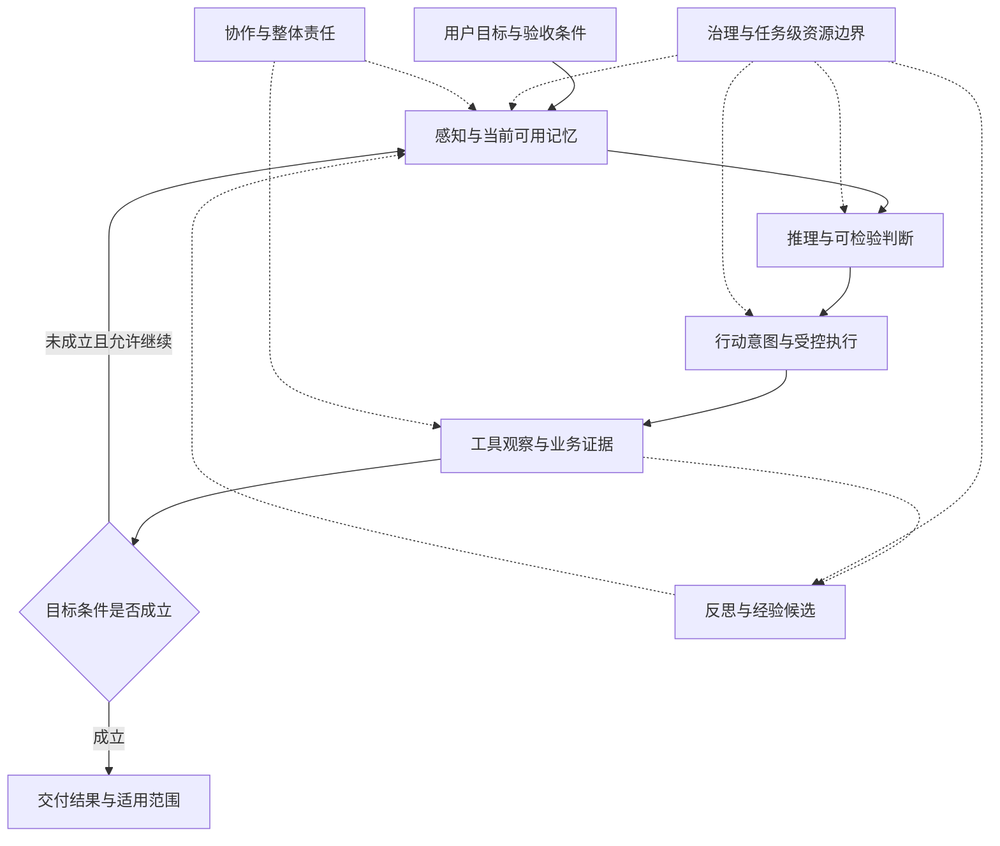

# Agent 设计模式之美知识体系

Agent 工程要解决的核心问题，是让模型在不断变化的环境里做出有依据的判断，并在明确的资源和权限边界内行动。Harness 是围绕模型的运行环境，负责上下文、工具、状态、预算、恢复和验收。模式的价值取决于它能否解决具体任务的断点，以及为此付出的整体代价。

这套知识体系覆盖当前本地的 47 篇课程资料，共 929 个 PDF 物理页：01 至 42 讲、开篇词、直播文章及 Loop Engineering、DeepSeek Harness、Jev 三篇加餐。课程仍在更新。双轴和模式机制来自课程；模式卡片中的适用条件、简化出口、验证标准，以及跨模块关系和学习练习，是依据原文形成的工程归纳。页码指 PDF 物理页。

## 知识导航

| 要回答的问题                   | 阅读入口                          |
| ------------------------------ | --------------------------------- |
| 为什么 Agent 需要 Harness      | [核心命题](#核心命题)             |
| 一个问题属于哪类功能和流程     | [双轴框架](#双轴框架)             |
| 某个模式怎样工作以及何时值得用 | [模式卡片](#模式卡片)             |
| 不同模式怎样接起来             | [模式关系与组合](#模式关系与组合) |
| 如何从实际任务选出最小方案     | [选型方法](#选型方法)             |
| 怎样判断机制真的改善了任务     | [验证与用户体验](#验证与用户体验) |
| 如何学习并检验自己是否掌握     | [学习路径](#学习路径)             |
| 回到哪一篇原文查证             | [课程资料索引](#课程资料索引)     |

## 核心命题

### 运行时决策需要明确边界

Agent 的一部分决策由模型在运行时生成，包括选择材料、形成假设、调用工具和改变执行路径。输出、行为和环境都可能变化，工程设计需要把这些变化纳入正常运行条件。[第01讲][课01]

Harness 管理模型能看到什么、能执行什么、能消耗多少资源、什么时候停止，以及执行后如何确认结果。模型可以提出判断和行动意图；身份、精确业务参数、授权和执行事实需要由可信数据与程序规则核对。Harness 能减少、拦截和暴露错误，不能保证模型判断永远正确。

对象模式和分布式工程仍然适用于各自的作用域。幂等、隔离、事务、事件记录与恢复等知识继续参与 Agent 系统设计。课程中的范式演进，重点在于增加对模型运行时决策的约束。

### 资源与结果一起衡量

上下文注意力、模型调用、工具调用、等待时间、人工接手和外部副作用，都有代价。增加一个环节应有具体理由：补足必要证据、提高判断质量、阻止错误传播、提前停止错误轨迹，或把潜在损失控制在可承受范围内。[第02讲][课02]、[第41讲][课41]

课程用连续步骤的正确率乘积说明错误可能累积。这个例子依赖简化假设；真实任务存在相关错误、中间验证、重试和恢复，不能把某个单步正确率直接当成所有 Agent 的通用成功率公式。

### 过程状态与业务成立分别核对

| 内容           | 它能说明什么                         | 还需要核对什么                         |
| -------------- | ------------------------------------ | -------------------------------------- |
| 模型判断或主张 | 当前提出了什么解释或方案             | 外部证据、适用范围、缺失事实           |
| 计划与进度     | 当前任务怎样安排以及推进到哪里       | 已完成步骤是否满足当前目标             |
| 工具结果       | 调用被受理、执行失败或产生了某种输出 | 真实副作用、业务对象与最终状态         |
| 许可           | 某项具体动作在一定条件下获准         | 动作、对象、版本、期限和条件是否仍一致 |
| 子代理工件     | 某个责任范围交付了材料               | 覆盖、来源、分歧及父目标是否满足       |
| 业务验收       | 指定条件在指定对象和版本上成立       | 后续变更是否使证据过时                 |
| 经验与技能     | 历史做法有复用候选价值               | 当前环境是否适用以及复用是否有效       |

`DONE`、HTTP 成功、全部 Worker 返回和用户目标达成，分别描述不同层面的事实。把它们混成一个成功标记，会使恢复、审批与汇总失去依据。[第14讲][课14]、[第23讲][课23]、[第32讲][课32]、[第40讲][课40]

### 五个工程观察点

阅读一个 Harness 时，先定位主循环、上下文管理、工具注册与执行、状态记录、治理边界。它们可以由现有程序、数据库、Git 或服务承担，不要求各自成为一个独立模块。[第04讲][课04]、[第05讲][课05]

课程的逆向五步法是：

1. **Detect**：找到用户输入、模型调用和工具结果回流的主循环。
2. **Classify**：按实际作用识别感知、记忆、推理、行动、反思、协作和治理控制点。
3. **Filter**：暂时放下不会改变决策、上下文、状态、行动或权限的外围代码。
4. **Map**：说明控制点解决什么问题、采用什么流程、怎样失败。
5. **Verify**：回到源码、相关测试与官方文档核对判断。

过滤是阅读顺序，不是永久忽略 UI、协议、类型或适配器。当问题涉及这些边界时，应沿具体调用链核对。课程中的八种产品是当时的工程样本，产品名称不能代替当前实现证据。

## 双轴框架

### 七类功能

| 功能               | 核心问题                 | 管理重点                       | 常见失效                           |
| ------------------ | ------------------------ | ------------------------------ | ---------------------------------- |
| 感知 Perception    | 这一步需要看什么         | 注意力、信息形态、探索范围     | 关键材料不可见，噪声占据窗口       |
| 记忆 Memory        | 过去什么还能影响现在     | 连续性、作用域、时效、来源     | 忘记约束，旧事实或猜测被长期沿用   |
| 推理 Reasoning     | 相信什么以及怎样检验     | 不确定性、推理预算、停止条件   | 有解释却无证据，错误假设持续展开   |
| 行动 Action        | 如何把意图变为正确效果   | 工具准入、依赖、副作用、恢复   | 参数或对象错误，未知结果被盲目重试 |
| 反思 Reflection    | 结果与基准有哪些偏差     | 修订、复验、经验与能力资格     | 自我肯定，局部补救被误当通用经验   |
| 协作 Collaboration | 谁负责什么以及怎样收回   | 分工、上下文、交接、组合验收   | 重复、漏项、责任丢失、冲突被抹平   |
| 治理 Governance    | 哪些行为在什么条件下获准 | 许可、影响范围、自治资格、追责 | 授权漂移，重试和派工扩大总影响     |

七类功能是诊断维度，不等于必须创建七个服务。同一个组件可以承担多个作用，先识别它的主要责任，再解释次要作用。[第02讲][课02]、[第04讲][课04]

### 六种执行拓扑

| 拓扑             | 怎样组织工作               | 适用的任务形态           | 重点防范                     |
| ---------------- | -------------------------- | ------------------------ | ---------------------------- |
| 链式 Chain       | 前一步产物成为后一步输入   | 顺序依赖稳定             | 早期错误逐段传播             |
| 路由 Route       | 按条件选择一条处理路径     | 类别、风险或能力差异明确 | 分类错误、无兜底出口         |
| 并行 Parallel    | 独立工作同时推进再汇总     | 分片独立且有共同口径     | 重复、相关错误、错误聚合     |
| 编排 Orchestrate | 根据状态与依赖安排就绪工作 | 执行顺序随任务状态变化   | 错误拆解、调度与状态失配     |
| 循环 Loop        | 观察结果后修正并继续       | 需要探索、检验或修复     | 无新证据仍重复，嵌套耗尽预算 |
| 层级 Hierarchy   | 分层分配责任、上下文与能力 | 权责和专业边界可区分     | 上下文与权限泄漏，父目标失守 |

编排侧重安排工作与依赖，层级侧重多层责任与边界；两者可以共存。并行需要聚合规则，循环需要退出规则，链式需要段间验收。[第02讲][课02]

### 28 个模式的课程坐标

| 功能 | 链式                  | 路由                      | 并行                      | 编排                  | 循环                          | 层级                          |
| ---- | --------------------- | ------------------------- | ------------------------- | --------------------- | ----------------------------- | ----------------------------- |
| 感知 | [语义压缩](#语义压缩) | [上下文分诊](#上下文分诊) | [多模态融合](#多模态融合) | —                     | [渐进发现](#渐进发现)         | —                             |
| 记忆 | [检索增强](#检索增强) | —                         | —                         | [进度追踪](#进度追踪) | [失败日记](#失败日记)         | [分层保留](#分层保留)         |
| 推理 | [思维链](#思维链)     | [复杂度路由](#复杂度路由) | [并行探索](#并行探索)     | —                     | [迭代假设验证](#迭代假设验证) | —                             |
| 行动 | [提示链](#提示链)     | [工具调度](#工具调度)     | —                         | [规划执行](#规划执行) | —                             | [护栏三明治](#护栏三明治)     |
| 反思 | [生成评审](#生成评审) | [技能包](#技能包)         | —                         | —                     | [自愈循环](#自愈循环)         | [经验回放](#经验回放)         |
| 协作 | [交接链](#交接链)     | —                         | [扇出聚合](#扇出聚合)     | —                     | [对抗评审](#对抗评审)         | [层级委派](#层级委派)         |
| 治理 | —                     | [审批门](#审批门)         | [渐进承诺](#渐进承诺)     | [可观测性](#可观测性) | —                             | [爆炸半径控制](#爆炸半径控制) |

坐标采用第 03 讲主矩阵，名称采用后续详讲；早期“生成批评”“审批门控”分别对应生成评审、审批门。空格不是待实现清单。同一个模式可以演进出不同拓扑，检索增强在第 13 讲就讨论了这种变化。第 40 讲还说明，后续 ADPS 分类把可观测性列为横切工程面。理解具体机制，比强制固定落格更重要。[第03讲 p4][课03]、[第13讲 p7 至 p8][课13]、[第40讲][课40]

## 模式卡片

每张卡片都把机制连接到适用条件与一个可检查结果。验证标准是设计和练习的起点；它不表示该机制已经在某个产品上取得收益。图中的坐标用来查找概念，实际实现强度随任务风险和代价调整。

### 感知模式

#### 上下文分诊

- **问题**：材料多，关键证据被噪声挤走。
- **机制**：P0/P1直接进入当前工作区；P2保留结论、证据、索引后压缩；P3只暴露可回取的读取句柄。记录selected／compressed／deferred／dropped及原因。
- **适用与简化**：仓库、知识库、长日志或连续工具任务值得分诊；材料小且边界清楚时可完整加载。
- **边界**：任务、安全与身份锚点，失败测试和错误反馈不能静默丢失；资源范围由程序在加载前校验，不能让模型决定租户归属。
- **验证**：给材料集加入大量无关资料后，必要的 P0/P1仍进入工作区；P3 能按读取句柄取回，越租户取回被拒绝。
- **原文**：[第07讲][课07] p3–8、p17–20。

#### 语义压缩

- **问题**：历史膨胀；压缩后忘了为什么走到当前状态。
- **机制**：先清理普通工具输出，再增量更新anchor，最后才极限压缩。anchor保存意图、已改动、决策、已排除方案与下一步；关键原件留回取路径。
- **适用与简化**：长调试、长客服、大量观察结果值得使用；短任务无压力时不必压。极限压缩反复触发应考虑交接。
- **边界**：异常类型、关键数字、路径、行号、失败方案及敏感/权限标签，不能被一句模糊摘要替代。
- **验证**：同一任务压缩前后仍能列出已证伪方案、定位关键错误证据，并选择相同的合法下一步。
- **原文**：[第08讲][课08] p2–7、p9–15；可回取的外置存储与不可逆摘要见 p17 至 p18。

#### 渐进发现

- **问题**：知道目标，不知道相关材料在哪里。
- **机制**：广扫便宜候选→聚焦少量高信号区域→沿强证据深挖；不足则换关键词再循环。原子工具、空间裁剪、预算、停止条件与DiscoveryTrace共同约束探索。
- **适用与简化**：陌生仓库、合同、事故日志值得探索；材料已给齐时直接使用。超大规模与跨库依赖可用持续更新的索引托底。
- **边界**：权限、轮数与成本上限；混用索引时明确新鲜度及冲突优先级；探索中间噪声不应全部灌回主上下文。
- **验证**：在有已知定位答案的材料空间中，限额内找到可核对的证据路径；无信号时停止并保留已查范围。
- **原文**：[第09讲][课09] p4–13、p16–20。

#### 多模态融合

- **问题**：文字、表格、图像、日志等的承重信号不在同一种表示里。
- **机制**：异构源走各自解析路径，再以页码、图号、标题等对齐。普通表格转结构；必要空间关系留图；精确数字抽成CSV/JSON再计算；长日志先过滤。保留FusionTrace。
- **适用与简化**：混合输入值得按形态设计；干净短文本无需额外流水线。可完整表达的流程图可转Mermaid。
- **边界**：单位、关系、行列结构和出处；视觉估读不能直接充当精确计算真值。
- **验证**：转换后能将一个数字结论追回原页/图/表，并与原始数据核对单位和计算结果。
- **原文**：[第10讲][课10] p3–6、p20–25。

### 记忆模式

#### 分层保留

- **问题**：规则、偏好、状态与猜测被同等保存、覆盖和使用。
- **机制**：按作用域、生命周期、权威来源、证据、预算分层；每层独立决定存储方式、加载、写入、覆盖、升层与失效。scratchpad先容纳候选，验证后再路由去向。
- **适用与简化**：跨会话助手、长期项目、多租户值得分层；层数应随真实作用域缩减，不必固定五层。
- **边界**：临时状态不能自动改写长期事实；低权威内容不能覆盖硬规则；未经验证的草稿不能直通长期层。
- **验证**：一次临时偏好只影响本任务；长期更新带证据与scope；过期条目不再进入当前工作集。
- **原文**：[第12讲][课12] p2–8、p16–20。

#### 检索增强

- **问题**：长期知识太大；相似文字未必是当前适用证据。
- **机制**：索引侧治理来源、权限、生效期和构建版本；候选索引回归后发布。查询侧过滤、混合召回、重排，返回source／version／scope／citation，记录RetrievalTrace。
- **适用与简化**：制度、手册、条款等知识证据值得检索；已知路径可直接读，代码结构可现场探索，精确业务状态应查业务系统。
- **边界**：RAG提供业务证据；id、账号、金额、批次由工具与SessionState确定性托管。过期或越权证据不能因相似度高而可用。
- **验证**：回归问题集命中当前有权使用的版本，引用回到原件；更新可回滚；执行参数不从召回文本生成。
- **原文**：[第13讲][课13] p3–5、p10–13、p18–23。

#### 进度追踪

- **问题**：局部步骤合理，整体目标、状态、对象或验收却漂移。
- **机制**：叙事态用锚（目标契约）、账（追加决策与证据）、集（当前工作集）；机械态托管带来源的精确参数；调度态维护DAG与ready/blocked状态。编排器对齐三者，以复诵、漂移哨兵、验证闸门收敛，从resume_packet恢复。
- **适用与简化**：长任务、多阶段、交接、严格参数执行值得使用；短无状态任务可只保留必要目标和结果。
- **边界**：目标变化显式记账；机械参数不经自然语言拼接；验收不过不能推进或报告完成。
- **验证**：中断后只用恢复包接回同一目标、里程碑和业务对象；一个未通过验收的里程碑保持needs_rework。
- **原文**：[第14讲][课14] p7–16、p19–24。

#### 失败日记

- **问题**：本次修好了，同类任务仍然重犯。
- **机制**：定义失败边界与分类，保存证据包，分开现象、根因、修复、教训、禁止动作；审查后按task_family＋tool＋mechanical_keys在关键入口召回，再观察行为变化。
- **适用与简化**：有复发价值或高损失失败值得沉淀；偶发无影响重试留普通日志即可。
- **边界**：只有经审查批准的条目进入召回；写入有来源和隔离；历史经验与当前事实重新核验，不能覆盖现行规则。
- **验证**：重跑同类场景时，在副作用前命中已确认教训，改变计划或参数；未审查条目不被召回，并统计重复失败率。
- **原文**：[第15讲][课15] p6–12、p14–21。

### 推理模式

#### 思维链

- **问题**：主路径已知，但中间判断无法检查，错误会沿推导传播。
- **机制**：将观察、拆解、推导、验证、决策组织成原子主张及依赖图；每步绑定证据引用、验证器与状态。
- **适用与简化**：规则和证据较明确、需要可追责的判断适用；简单查询可直接回答；存在竞争口径或缺失证据时，先补证或比较解释。
- **边界**：模型提出主张，外部证据与验证器决定能否通过；失败上游使依赖项失效。可检查记录不等于隐藏思维链。
- **验证**：令一个上游证据失效，其依赖结论不能继续保持通过状态。
- **原文**：[第17讲][课17]，第 18、20—21 页。

#### 复杂度路由

- **问题**：简单事过度推理，困难或高风险事投入不足。
- **机制**：拆成任务原子，以意图、证据、执行对象准备度、风险生成 RouteDecision，控制推理方式、预算与人工闸门；运行中允许重新分流。
- **适用与简化**：任务差异大、成本与风险差异明显时适用；同质简单任务可用固定规则，路由成本不能超过节省的成本。
- **边界**：复杂度与风险分开；增加推理不能补齐身份、证据或写入授权。
- **验证**：短句中的敏感修改仍触发写入前审批；证据缺失被显式记录为阻塞项。
- **原文**：[第18讲][课18]，第 9—13 页。

#### 并行探索

- **问题**：存在多个合理口径，单条路径容易受早期假设束缚。
- **机制**：隔离不同路径的口径、上下文、证据要求及验证器，独立返回结果，再聚合合格路径并保留异议与失败原因。
- **适用与简化**：竞争解释或高错误成本判断适用；已知唯一简单路径时不必多路；重复相同提示不能提供充分的视角差异。
- **边界**：票数、置信度不等于事实或授权；合法口径冲突可转人工，不强求唯一答案。案例中的“弱通过”不能解释为高风险写入许可。
- **验证**：构造两个有效但冲突的口径，系统保留分歧并按风险闸门处理，而非仅凭多数自动写入。
- **原文**：[第19讲][课19]，第 9—11、19—20 页。

#### 迭代假设验证

- **问题**：根因未知，一次猜测缺少足够证据。
- **机制**：提出可证伪假设，执行检查取得新观察，判定验证或推翻，更新假设；锁定已证事实，并设置预算、收敛判据和原地打转检测。
- **适用与简化**：诊断、归因、逐步补证适用；规则与证据已齐时可直接推导；没有新观察的反复改写没有验证收益。
- **边界**：到预算上限必须退出；未收敛要交付已知事实、未解释缺口与下一步，不把猜测升级为事实。
- **验证**：连续检查没有新增证据时触发停止或接管，且记录未解决假设。
- **原文**：[第20讲][课20]，第 4、14—16 页。

### 行动模式

#### 工具调度

- **问题**：选对工具，仍可能在错误对象、阶段或次数上执行。
- **机制**：先构造最小完备工具前沿，再选择候选；结构化动作经身份、策略、配额、状态及审批准入，才进入受控执行入口。
- **适用与简化**：多工具、敏感写入或多阶段任务适用；少量只读工具可简化选择层，保留必要的参数与对象检查。
- **边界**：发现、选择、准入、执行各有责任；拒绝一次调用不代表原任务完成。进程内配额或“读过状态”不能保证跨进程幂等；回执丢失可能是 UNKNOWN。
- **验证**：合法工具提出越权调用时，执行器未被调用；不确定付款结果先按幂等键查询，而非直接重试。
- **原文**：[第22讲][课22]，第 1—2、18、27 页。

#### 规划执行

- **问题**：长任务偏离目标，失败后整体重跑会重复已完成副作用。
- **机制**：把目标、范围、不变量与验收编译成依赖计划；维护稳定步骤身份、版本及检查点，局部修复失败步骤和必要的下游依赖。
- **适用与简化**：有依赖、暂停恢复、审批或不可重复动作的任务适用；短任务可直接执行；易变环境避免提前固定过多细节。
- **边界**：计划 DONE 是流程状态，业务成功还需外部回执和验收；检查点不代替效果账本。对象版本变化可能使原审批失效。
- **验证**：模拟远端提交后本地崩溃，恢复先核实远端效果，不重新执行已确认成功的付款。
- **原文**：[第23讲][课23]，第 8、12—14 页。

#### 提示链

- **问题**：错误中间产物进入下游，各段却都报告成功。
- **机制**：分成职责清楚的链段；具名工件绑定结构、版本与来源，在进入下游上下文前经过结构、语义、外部事实及来源闸门。
- **适用与简化**：能定义独立中间契约、错误传播成本高时适用；短而紧密耦合的任务可合并链段。
- **边界**：JSON 合法不是事实正确；可信事实源须独立于待检工件；重新生成也必须再次过同一道闸门，不能无信息地无限重试。
- **验证**：输入格式合格但总额与台账不符的工件，下游付款申请不得生成。
- **原文**：[第24讲][课24]，第 2—4 页。

#### 护栏三明治

- **问题**：副作用前缺少拦截，工具返回后敏感结果又被直接发布。
- **机制**：PRE 检查输入及授权，受控 TOOL 执行，POST 检查可发布结果；分别保存原始／有效参数、原始／发布输出，已发生影响进入补偿流程。
- **适用与简化**：敏感写入、不可逆动作、输出隐私适用；低风险只读场景按风险选择必要守卫。
- **边界**：POST 拦发布不能撤销外部效果；“需要回滚”标记不是补偿成功。审批等待后还需复查易变状态，组合调用也要考虑来源到输出的风险。
- **验证**：外部付款成功后 POST 拒绝发布，效果账本仍记录已付款，直到外部确认补偿才标记恢复。
- **原文**：[第25讲][课25]，第 4、10、13、17 页。

### 反思模式

#### 生成评审

- **问题**：评审意见被当作放行，旧版本的通过状态被带到新版本。
- **机制**：生成者交候选，评审者提交问题与证据，验收策略裁决当前版本；修订后成为未评审的新候选，显式复审才能通过。
- **适用与简化**：有可复核标准的报告、代码或方案产物适用；低成本常规产物可用单次确定性检查。
- **边界**：评审者不直接授予发布状态；证据非空不等于真实；换模型增加视角，不能代替独立事实源。
- **验证**：通过的版本修改后，旧评审结论不能使新版本自动成为 ACCEPTED。
- **原文**：[第27讲][课27]，第 3—4、17、20 页。

#### 技能包

- **问题**：一次偶然成功被固化成可反复调用的“能力”。
- **机制**：成功轨迹参数化为候选技能，经独立结果、激活、流程、相对收益及新鲜度验证后取得资格；按当前资格路由，复用后持续监测、降级或退役。
- **适用与简化**：稳定、重复且有复用收益的流程适用；一次性或简单动作无需包装成技能。
- **边界**：SKILL.md 是载体，不是能力证明；验证资格绑定版本、环境、验证集和有效期。技能文字不能代替运行时权限与对象检查。
- **验证**：政策或工具版本变化后，旧资格失效；候选技能重新验证前不能沿用 VERIFIED 标记进入正式路由。
- **原文**：[第28讲][课28]，第 3、9—10 页。

#### 经验回放

- **问题**：经验被召回却没有改变行动，偶然成功还被错误归因。
- **机制**：保留原轨迹与分层教训，召回后过滤版本、时效与风险，注入必要背景；记录是否采用、行动差异和外部结果，再更新具体经验的信用与生命周期。
- **适用与简化**：历史教训能影响后续判断时适用；当前业务事实应重新查询；成熟、可执行且可验证的做法可转入相应机制。
- **边界**：召回、注入、采用、改善是不同事实；任务成功不能给所有同场经验记功；统计更新不证明因果，转成护栏或技能仍需独立准入。
- **验证**：未改变行动的经验不获得“采用后有效”信用；有效性记录能够追到采用证据及结果来源。
- **原文**：[第29讲][课29]，第 4—5、8—13 页。

#### 自愈循环

- **问题**：故障触发无限修补，修改测试还可能制造虚假的成功。
- **机制**：失败信号触发诊断与补丁提案，应用前审查范围，应用后运行独立原验收；用故障签名、补丁指纹、轮数和影响范围识别不收敛，失败则回滚验证或接管。
- **适用与简化**：可撤销代码、配置及受控环境故障适用；固定暂时性错误可简单重试；不可逆业务效果需要另行补偿与授权。
- **边界**：修复器不能自行降低验收或提高权限；测试更新由独立验证策略管理；撤销代码不等于恢复业务现场。
- **验证**：重复故障与同类失败补丁触发停止；回滚后实际环境和必要检查恢复基线，而不只检查“调用过 rollback”。
- **原文**：[第30讲][课30]，第 7、10—12、17—18 页。

### 协作模式

#### 层级委派

- **问题**：子任务各自完成，父目标仍有重复、缺口或冲突。
- **机制**：稳定责任人保留总目标，拆出明确责任；执行者在相对隔离的环境执行，返回带来源的工件；分别验收单项工件与组合结果。
- **适用与简化**：独立分片、专业权限分离或大量局部探索值得考虑；短任务、密集隐含依赖、交付物说不清时保留单Agent。
- **边界**：委派不免除主管的整体责任；角色名和执行者自报不能证明覆盖；新会话不代表权限或工作区隔离。
- **验证**：移除一个执行者会缺少明确责任；所有预期责任被合格工件覆盖，重复、旧版本和全局违约均能被拒绝。
- **原文**：[第32讲][课32] p6–12；多代理采用门槛见[第31讲][课31] p7–9。

#### 扇出聚合

- **问题**：多路材料被拼接或投票，差异、缺席和来源关系丢失。
- **机制**：盘点缺席→归一对象、版本、单位和口径→去重及来源血缘→分类处理冲突→检查跨分片约束。
- **适用与简化**：自然分片、多源核查、等待成本较高；单次处理够用、分支强依赖或没有共同口径时不扇出。
- **边界**：同源材料被发现三次不等于三份独立证据；投票须针对同一命题、对象、版本和取值语义，判断具有足够独立性。
- **验证**：缺失分片明确披露；同源转述不增加证据票数；限定条件与未决冲突保留；报告准入和业务结论分开。
- **原文**：[第33讲][课33] p6–16。

#### 对抗评审

- **问题**：异议被记录，却不能阻止不合格工件放行。
- **机制**：分开提案、举证、修订与裁决责任；结构化blocker进入状态转移；新版本重新评审，回执绑定工件及来源摘要。
- **适用与简化**：重要内容判断、职责分离及错误会进入后续业务；普通质量改善用生成评审，类型、余额、身份等硬检查用程序。
- **边界**：多模型不能代替独立事实；评审独立性包括身份权限、上下文、数据和认知条件；优点不能抵消硬阻断项。
- **验证**：未关闭blocker阻止放行；正文或来源改变后旧回执失效；每位评审者增加明确风险覆盖或证据条件。
- **原文**：[第34讲][课34] p6–13。

#### 交接链

- **问题**：换执行者后使用旧状态，事实、责任和恢复位置脱节。
- **机制**：每棒声明输入和产出；事实记录生产者与证据；不可变接力棒按版本推进，接收验收成功才移交控制权与责任。
- **适用与简化**：专业责任顺序转移、跨会话或系统续作；同一运行时的简单步骤只需提示链或状态记录，独立任务可并行。
- **边界**：发送成功不是签收成立；失败保留最后已验收版本；外部回执缺失不能推出动作未执行，重试前先查真实状态。
- **验证**：旧事实绑定被拒绝且版本不前进；能指出失败阶段、拒绝原因、最后检查点与接手人；重试具有稳定执行身份。
- **原文**：[第35讲][课35] p6–12。p8“接手者问题”表内容与正文不符，归纳以正文契约和实例为准。

### 治理模式

#### 审批门

- **问题**：一句同意被借给新参数、新对象或长期权限。
- **机制**：先把事实、差异、影响与可逆性整理成可审提案；按规则路由自动、人审或拒绝；许可绑定动作、对象、身份、策略、期限和次数，执行前重验。
- **适用与简化**：重大外部影响、业务例外或责任性决定；稳定低风险动作可自动放行。证据不足先补证，不把未完成调查交给审批人。
- **边界**：硬拒绝不能靠普通批准绕过；对象、策略或前置条件变化需重新判断；放宽审批规则也要独立授权。
- **验证**：批准798人清单后增加两人，旧票据不可用；过期、撤销、身份不符或次数耗尽不能执行；恢复和重试不绕开检查。
- **原文**：[第37讲][课37] p3–7、p13–17。

#### 爆炸半径控制

- **问题**：合法动作被循环、并发、重试或子任务放大实际后果。
- **机制**：限定资源、对象、数量、速率、资金、时间与传播；子额度从父额度预留；每次外部效果前原子占用许可，配合稳定幂等键和对账。
- **适用与简化**：会改变外部世界或消耗稀缺资源；先找不可承受的业务损失，只限制必要维度，不能机械装齐所有限额。
- **边界**：拆工作不能复制权限；硬边界由执行者之外管理；技术沙箱不替代业务额度；UNKNOWN继续占额度，未确认不能释放。
- **验证**：子额度之和不超过父额度，对象集合不扩张；重复执行不突破累计上限；并发领取不会双花；未知结果等待独立确认。
- **原文**：[第38讲][课38] p3–7、p9–14。

#### 渐进承诺

- **问题**：低风险成功被借给高风险能力，或试点通过便永久全面放权。
- **机制**：分别管理单任务渐进落地与跨任务自治晋级；按能力、版本、环境和范围收集可信证据，冻结证据窗口并审批；严重事件及时撤销相关权限。
- **适用与简化**：逐步进入真实业务、需要持续调整自治范围；不做整个Agent的总信任分，也不把每次晋级变成大量人工材料。
- **边界**：一次dry-run不升级长期权限；重复成功、简单样本、旧版本成绩不能证明新权限；自主级仍有硬边界和永久人审事项。
- **验证**：同一成功不能重复计数；证据覆盖拟开放的风险切片；窗口新增失败使旧申请失效；事故后旧凭证与旧成绩不可直接恢复权限。
- **原文**：[第39讲][课39] p3–6、p9–15。

#### 可观测性

- **问题**：接口成功但业务未兑现，无法还原原因和责任。
- **机制**：用共同标识、因果链接、版本及证据引用关联请求、提案、策略、批准、额度、权限、工具与业务结果，并检查必需控制是否缺失。
- **适用与简化**：调查、恢复、评测和归责闭环；已有平台可继续使用，先补真实投诉路径，记录够用而非保存一切。
- **边界**：过程日志不替代业务结果确认；历史调查、离线重放测试和重新办理业务不同；脱敏后仍应能核对对象，关键记录不得随意覆盖。
- **验证**：从投诉找到当时输入、实际规则、许可和外部结果；识别pending与completed；能在不重复外部动作的条件下检验修复。
- **原文**：[第40讲][课40] p2–5、p8–10、p13–17。课程说明后续ADPS将其调整为横切工程面X1。

## 概念边界

| 容易混淆的概念         | 各自承担什么责任                                                      | 怎样连接                                                             |
| ---------------------- | --------------------------------------------------------------------- | -------------------------------------------------------------------- |
| 感知与记忆             | 感知安排当前看到什么；记忆安排跨时间保留、更新、召回和遗忘什么        | 长期记忆进入当前工作区前仍需检查范围、时效与用途                     |
| 检索增强与业务查询     | 检索提供适用规则和知识证据；API 或 SQL 提供当前对象、标识、金额与状态 | 在决策点合流，执行参数绑定权威数据                                   |
| 渐进发现与迭代假设验证 | 前者寻找相关材料；后者用新材料区分竞争解释                            | 一次假设检验可以调用发现，但搜索命中不能直接证明根因                 |
| 并行探索与扇出聚合     | 前者展开不同解释或方案；后者归一多路材料、来源与结论                  | 比较前先确认命题、对象和版本相同，保留未决分歧                       |
| 提示链与交接链         | 前者约束顺序工序的产物；后者还处理执行者、上下文和责任换手            | 单一运行时可使用简单段间契约，执行者和责任换手时再增加接收与恢复责任 |
| 规划执行与工具调度     | 规划决定哪项工作就绪；调度检查这一次动作能否执行                      | 步骤就绪仍需当前身份、参数、权限和业务条件                           |
| 生成评审与对抗评审     | 前者检查并改进候选版本；后者让独立异议约束放行                        | 需要职责分离与阻断责任时再提高评审强度，确定性条件交给程序           |
| 失败日记与经验回放     | 前者形成经核实的教训；后者观察教训如何被采用及是否有效                | 原始日志、已确认经验、召回命中、实际采用和收益分别记录               |
| 经验回放与技能包       | 前者为判断提供可校准背景；后者提供参数化、可验证的重复做法            | 稳定做法满足独立验证条件后才取得技能资格                             |
| 审批门与爆炸半径控制   | 前者批准特定动作；后者限制累计后果和传播范围                          | 获批动作仍消耗额度，合法的多次动作不能突破总边界                     |
| 审批门与渐进承诺       | 前者处理本次许可；后者调整长期自治范围                                | 一次成功执行不会自动授予长期权限                                     |
| 可观测性与业务验收     | 前者记录因果过程；后者确认业务条件成立                                | 从证据链定位真实结果，日志齐全不能替代结果核验                       |

这些区分来自各模式的责任边界。实现可以共享一个状态存储、执行入口或验收函数；是否拆成独立组件，需要另外证明维护和运行收益。[第13讲][课13]、[第20讲][课20]、[第22讲][课22]、[第26讲][课26]、[第35讲][课35]、[第42讲][课42]

## 模式关系与组合

### 整体关系图

下图表示信息、结果和约束的关系。具体任务可以只采用其中需要的功能，不要求按图建立固定流程或多个 Agent。

模型提出的判断进入执行前，应经过必要的事实与准入检查。执行观察返回后，需要区分失败、结果未知、受理中与业务完成。结果未知时优先查证实际效果；审批等待时保留等待状态，不能把它们当作可以反复执行的普通故障。[第22讲][课22]、[第23讲][课23]、[第42讲][课42]

### 常见组合关系

| 可组合的模式           | 连接理由                               | 接缝需要保留什么                             |
| ---------------------- | -------------------------------------- | -------------------------------------------- |
| 上下文分诊与语义压缩   | 先判断材料用途，再决定是否压缩         | 当前关键证据、失败反馈、原件回取路径         |
| 渐进发现与迭代假设验证 | 假设决定查什么，新证据决定是否改假设   | 已查范围、观察结果、被证伪路线与停止条件     |
| 分层保留与检索增强     | 保存策略决定哪些知识可以在当前任务使用 | 权威来源、作用域、生效期、版本与引用         |
| 进度追踪与规划执行     | 让执行依赖与当前目标、事实和检查点对齐 | 新要求、已完成事实、受影响步骤与对象身份     |
| 提示链与生成评审       | 检查工序产物后再让后续工序消费         | 当前候选版本、验收标准与原始证据             |
| 层级委派与扇出聚合     | 分出去的责任需要在整体目标上收回来     | 责任范围、缺席、来源关系、冲突与全局约束     |
| 工具调度与治理模式     | 可选工具需要在实际执行入口取得许可     | 当前参数、对象、范围、批准与剩余额度         |
| 自愈循环与失败日记     | 本次修复产生未来可检验的教训候选       | 真实根因、补丁效果、未解问题和适用条件       |
| 技能包与复杂度路由     | 可重复做法按当前任务与资格选择         | 技能版本、环境、有效期、拒选与升级出口       |
| 可观测性与渐进承诺     | 自治调整依赖真实任务证据               | 能力与风险切片、失败样本、证据窗口及撤权条件 |

组合关系可以是前后供料、内部嵌套、每次执行的约束，或多步骤共享能力。审批、范围检查和护栏可以放在同一个执行入口；它们的责任不同，不要求成为三个服务。[第42讲][课42]

### 五类接缝

| 接缝 | 需要回答的问题                     | 常见错误                                           |
| ---- | ---------------------------------- | -------------------------------------------------- |
| 任务 | 局部交付怎样满足当前父目标         | 分片都结束，目标仍漏项；旧成果被直接视为满足新要求 |
| 状态 | 谁持有当前事实，接手者从哪里恢复   | 使用旧摘要；等待审批、执行失败与结果未知混在一起   |
| 证据 | 下游能否核对关键主张和限定条件     | 只传结论；所有评审者读同一份可能错误的摘要         |
| 权限 | 当前动作在此刻和此范围是否仍获准   | 用旧批准执行新对象；自愈或子任务扩展权限           |
| 预算 | 所有子步骤合计会消耗多少资源与影响 | 外层三轮、内层五次各自计数，实际形成十五次尝试     |

任务级上限约束全部嵌套执行，各组件可以另有较小上限。证据、参数、对象或版本变化时，应重新检查受影响的判断和许可。共享状态需要明确更新责任，避免规划器、执行者和接手者各自维护互不一致的事实。[第42讲 p3 至 p11][课42]

## 选型方法

### 从任务到最小方案

1. **定义完成条件和禁止事项。** 指明业务对象、权威事实来源、可接受结果和不可接受影响。缺少必要证据时，补证或转人工也可以是正确结果。
2. **建立最小基线。** 固定输入、确定计算和稳定流程优先使用已有程序。自然语言入口可以只增加一次理解调用；材料短且齐全时可以一次处理。
3. **定位具体断点。** 区分材料缺失或过期、判断错误、执行失败、恢复状态错误、协作漏项以及授权不足。
4. **用双轴找少量候选。** 判断要补哪类职责，再按依赖、分支、探索或责任边界安排工作。
5. **比较整体结果和代价。** 在同一批代表性任务上比较完成条件、新增错误、耗时、费用与人工返工。
6. **保留改议和撤除条件。** 明确在哪些任务启用，哪些变化会使当前选择失效，何时可以简化。

课程早期的 ASSESS、ROUTE、SELECT，可以用于第 3 至第 4 步：评估七类功能需求，再选执行拓扑与对应模式。“首版三至七个模式”是作者控制复杂度的启发式；一个程序或一次模型调用足够时，就没有必须凑齐模式数量的理由。[第03讲][课03]、[第41讲 p3 至 p17][课41]

### 按断点查模式

| 具体断点                   | 优先检查                     | 可选模式                         | 简化出口                       |
| -------------------------- | ---------------------------- | -------------------------------- | ------------------------------ |
| 关键错误信息进不了下一步   | 信息是否被截断或错误分诊     | 上下文分诊、语义压缩             | 短结果保留全文，先修确定性投影 |
| 不知道证据在哪里           | 搜索范围、材料形态与新鲜度   | 渐进发现、多模态融合             | 已知文件直接读，精确对象直接查 |
| 正确材料仍产生错误判断     | 主张、证据和验证依据         | 思维链、迭代假设验证、生成评审   | 确定性规则直接计算和校验       |
| 简单任务也花费大量推理     | 任务与风险的差异、路由开销   | 复杂度路由                       | 同质任务使用固定处理路径       |
| 恢复后重复做或忘记新要求   | 持久输入、事实与执行检查点   | 进度追踪、规划执行、交接链       | 先接通最新要求与最小恢复状态   |
| 多个子任务各完成却整体漏项 | 分工边界与组合验收           | 层级委派、扇出聚合               | 单个执行者足够时保留单任务     |
| 旧评审给新版本背书         | 候选版本、评审对象和放行责任 | 生成评审、对抗评审               | 先固定评审材料并显示过时状态   |
| 循环、重试或并发扩大影响   | 真实动作入口与累计预算       | 工具调度、爆炸半径控制、自愈循环 | 只限制实际风险所需维度         |
| 同类失败反复发生           | 根因是否确认、教训是否采用   | 失败日记、经验回放、技能包       | 偶发失败保留普通日志           |
| 要逐步提高自治范围         | 新权限需要什么证据与授权     | 渐进承诺、审批门、可观测性       | 不需要长期放权时保留本次许可   |

表中候选是诊断后的备选方案。材料缺失应先取得材料，权限不足应处理授权，不能用更多推理或更多评审来替代。[第41讲][课41]、[第42讲][课42]

### 四种任务的组合示例

以下是用课程原则构造的练习场景，组合强度仍需按真实任务调整。

| 任务                     | 最小路径                                   | 何时增加机制                                       | 验收重点                                         |
| ------------------------ | ------------------------------------------ | -------------------------------------------------- | ------------------------------------------------ |
| 比较三份短且完整的文件   | 一次阅读并逐项比较                         | 文件长、修订多或信息分散时，再考虑独立分片与聚合   | 每项结论有来源，例外条件未被抹掉                 |
| 排查未知故障             | 渐进发现与可证伪假设交替推进               | 修复依赖明确后再安排执行；修补可撤销时考虑有界自愈 | 新证据是否区分假设，原要求的检查是否通过         |
| 阅读全部课程形成知识体系 | 按材料形态读取，明确分工，再按共同口径汇总 | 规模确实超过单上下文且分片独立时采用委派           | 全范围有责任和来源，缺失与分歧可见               |
| 已知步骤的业务办理       | 普通程序按依赖执行，动作入口检查授权与范围 | 只有路径会随证据变化时才增加模型规划               | 对象与参数正确，实际业务结果核实，未知结果先对账 |

## 验证与用户体验

### 三层证据

| 层次             | 可以支持的结论                               | 不能直接推出的结论                   |
| ---------------- | -------------------------------------------- | ------------------------------------ |
| 机制验证         | 某输入在特定路径被保留、拒绝、绑定或恢复     | 模型会正确使用输入，所有场景都可靠   |
| 真实模型任务验证 | 在指定模型、权限与任务集合上出现某种行为     | 新模型、新业务和长期运行仍有同样收益 |
| 实际使用验证     | 用户完成任务、等待、返工和异常处理的实际表现 | 任意人群和任务的通用改善             |

固定夹具能检验边界；真实模型任务能检验行为；使用反馈能检验体验。选择证据强度要与所声称的收益匹配，不必为一个可直接核对的文本整理运行产品全量测试。[第41讲][课41]、[第42讲][课42]

### 比较整体收益

| 维度         | 观察内容                                         | 解释限制                           |
| ------------ | ------------------------------------------------ | ---------------------------------- |
| 任务质量     | 业务条件满足、事实正确、范围完整、缺失是否披露   | 工件格式与报告长度不是正确性指标   |
| 可靠性与边界 | 重复失败、重复效果、恢复遗漏、越权与未知结果     | 没观察到事故不能证明风险不存在     |
| 时间与成本   | 总耗时、模型与工具调用、可用费用计量、等待与重试 | 缺失计量保留未知，不视为零         |
| 人工负担     | 澄清、审批、重述、修正与接管次数                 | 不应通过隐藏缺失或绕过许可降低数量 |
| 使用体验     | 状态能否理解、下一步是否明确、成果能否续接       | 更多流程可见不一定意味着更容易使用 |

比较时保持任务、模型、权限和完成条件可比，保留失败与超时。少量重复适合发现退化，不足以证明通用成功率。组件分数提高但整体延迟或返工增加时，需要重新判断是否保留该组合。[第42讲][课42]、[Jev 加餐][课Jev]

### 把边界表达给用户

将课程的状态、许可和验收原则用于产品交互，可以形成以下检查条件：

- 正常路径自动执行已获准的低风险动作；额外审批有明确的对象、原因和影响。
- 中断后保留成果与当前要求；需要用户补充时，只请求真正缺失的信息。
- 等待显示等待什么，失败说明已知原因与下一步；结果未知明确表示正在查证。
- 任务已结束、范围完整、验收通过分别表达；缺失和未决分歧在交付处可见。
- 评审注明针对哪个版本，代码改变后保留旧意见并标明适用状态。
- 额度或权限耗尽时，显示尚未执行的范围与有效处理方式；普通重试不能暗中扩大权限。

这些是从工程边界推导出的交互验收条件。具体文案和流程是否减少理解与操作负担，需要在实际界面和任务中核对。

## 加餐在知识体系中的位置

| 加餐                 | 对体系的增量                                                                             | 使用边界                                                                                           |
| -------------------- | ---------------------------------------------------------------------------------------- | -------------------------------------------------------------------------------------------------- |
| Loop Engineering     | 把工程控制对象扩展到完整任务轨迹，连接意图、状态、对象身份、证据、预算、准入、验收与退出 | 四层运行时、特定购物场景和每轮沉淀技能是作者的设计或案例；研究任务不必固定成 DAG，技能仍需资格验证 |
| DeepSeek Harness dsh | 用插件生命周期、统一工具管线和追加会话日志说明能力怎样组合、执行和记录                   | 全插件化是实现选择；插件卸载不撤销外部效果，插件化不自动提供隔离                                   |
| Jev                  | 以 Choice、Score、Noul 处理明确候选、等级或命题判断，可作为筛选、路由和评价的候选组件    | 保留拒选与信息不足出口；相对第一不证明适用，分数不授予权限，必须比较完整任务的总成本               |

[Loop Engineering p24、p27 至 p29][课Loop]、[dsh p4、p6、p8 至 p12][课dsh]、[Jev p2 至 p4、p6 至 p11][课Jev]

## 学习路径

学习的输出应能被检查。阶段之间存在知识依赖，不要求先实现所有模式才能学习下一阶段。

| 阶段           | 学习重点与课程                     | 练习输出                                   | 掌握标准                                                             |
| -------------- | ---------------------------------- | ------------------------------------------ | -------------------------------------------------------------------- |
| 理解运行环境   | 核心命题、双轴与逆向方法，01 至 05 | 一个不超过十个框的主循环图及证据位置       | 找到输入、模型调用、结果回流与真实执行边界；说明程序是否已经足够     |
| 建立可信输入   | 感知与记忆，06 至 15               | 一组材料的分诊方案、保真摘要与恢复记录     | 关键约束和原始证据可追回；临时猜测没有变成长期事实                   |
| 做出可检验判断 | 推理，16 至 20                     | 两个竞争假设、区分它们的检查及停止条件     | 结论随证据更新，缺失信息保持未知；可解释为何值得投入更多推理         |
| 控制执行与修复 | 行动与反思，21 至 30               | 动作提案、依赖计划、故障恢复与版本复验说明 | 区分就绪与获准、受理与完成；未知效果先查证，自愈不改变原验收         |
| 分配并收回责任 | 协作，31 至 35                     | 责任表、工件要求、聚合规则与交接内容       | 缺一分片能明确指出缺口；同源重复不增加证据；旧版本意见不能放行新版本 |
| 治理并评估组合 | 治理与选型，36 至 42               | 五类接缝图、权限范围、最小候选比较表       | 累计影响有上限，自治变更有证据和授权；能指出可以删掉或简化的模式     |

三个加餐在对应阶段按需补读。Loop 对照完整运行轨迹；dsh 对照能力装配、执行入口和日志；Jev 对照一个明确且可拒选的判断任务。完成练习后再决定是否需要实现或实验。[第04讲][课04]、[第28讲][课28]、[第41讲][课41]、[第42讲][课42]

## 知识应用记录

每次把知识用于设计，保留一张简短记录即可：

| 项目 | 要记录的内容                                     |
| ---- | ------------------------------------------------ |
| 任务 | 用户目标、对象、完成条件与禁止事项               |
| 断点 | 已观察到的失败及对应证据，或明确标记的待验证风险 |
| 基线 | 当前程序或最小 Agent 怎样处理                    |
| 候选 | 对应功能、执行拓扑及最少需要的模式               |
| 接缝 | 下游需要的状态、证据、许可和预算                 |
| 比较 | 任务结果、成本与人工操作怎样核对                 |
| 决定 | 采用、简化、暂缓或移除，以及再次判断的条件       |

这张记录连接“概念理解”与“工程决定”。记录可以放在已有任务说明或评审材料中，不必另建流程系统。

## 课程资料索引

按课程原文回查。导论用于模块整体定位，详讲对应模式卡片；开篇、直播和加餐补充整体观点与具体实现。

| 资料      | 原文                                                                  | PDF 页数 |
| --------- | --------------------------------------------------------------------- | -------- |
| 第01讲    | [01｜范式之变：GoF的崩塌和分布式的血脉进化][课01]                     | 22       |
| 第02讲    | [02｜双轴框架（上）：理解认知功能与执行拓扑][课02]                    | 15       |
| 第03讲    | [03｜双轴框架（下）：理解与使用Agent设计坐标系][课03]                 | 13       |
| 第04讲    | [04｜逆向五步法（上）：工业级Agent框架源码如何解码][课04]             | 24       |
| 第05讲    | [05｜逆向五步法（下）：8个Harness产品拆成工程地图][课05]              | 15       |
| 第06讲    | [06｜感知模块导论：如何优雅设计Agent感知层？][课06]                   | 15       |
| 第07讲    | [07｜上下文分诊：如何科学分流处置不同信息][课07]                      | 23       |
| 第08讲    | [08｜语义压缩：让200K装下1M的日志][课08]                              | 19       |
| 第09讲    | [09｜渐进发现：信息的觅食循环][课09]                                  | 22       |
| 第10讲    | [10｜多模态融合：日志、SQL和PDF一起进Agent][课10]                     | 27       |
| 第11讲    | [11｜记忆模块导论：从草稿纸到长期记忆，建立Agent的经验沉淀秩序][课11] | 17       |
| 第12讲    | [12｜分层保留：给Agent的记忆建一套货架][课12]                         | 22       |
| 第13讲    | [13｜检索增强：Agent的知识库和证据链][课13]                           | 25       |
| 第14讲    | [14｜进度追踪：长任务中别让Agent走丢][课14]                           | 26       |
| 第15讲    | [15｜失败日记：让Agent把摔过的跤变成本事][课15]                       | 23       |
| 第16讲    | [16｜推理模块导论：让Agent想得清楚，也想得起来][课16]                 | 13       |
| 第17讲    | [17｜思维链：给Agent的判断留下一条可检查的路径][课17]                 | 23       |
| 第18讲    | [18｜复杂度路由：一件事该消耗多少推理][课18]                          | 33       |
| 第19讲    | [19｜并行探索：一题多解，择优录取][课19]                              | 24       |
| 第20讲    | [20｜迭代假设验证：用科学方法猜至证据的收敛][课20]                    | 28       |
| 第21讲    | [21｜行动模块导论：把任务安全地做好][课21]                            | 21       |
| 第22讲    | [22｜工具调度：从候选选择到执行准入][课22]                            | 33       |
| 第23讲    | [23｜规划执行：用全局计划约束局部恢复][课23]                          | 18       |
| 第24讲    | [24｜提示链：用段间契约阻断错误传播][课24]                            | 18       |
| 第25讲    | [25｜护栏三明治：高风险行动的前中后防线][课25]                        | 24       |
| 第26讲    | [26｜反思模块导论：让Agent站到自己的结果之外][课26]                   | 28       |
| 第27讲    | [27｜生成评审：让每个版本独立接受审查][课27]                          | 22       |
| 第28讲    | [28｜技能包：从成功轨迹到可验证能力][课28]                            | 23       |
| 第29讲    | [29｜经验回放：让经验在复用中持续校准][课29]                          | 23       |
| 第30讲    | [30｜自愈循环：让自动修复在边界内收敛][课30]                          | 20       |
| 第31讲    | [31｜协作模块导论：人一多，就需要把边界说清楚][课31]                  | 15       |
| 第32讲    | [32｜层级委派：把大目标拆成可验收的责任][课32]                        | 13       |
| 第33讲    | [33｜扇出聚合：让多路证据保留差异再汇成结论][课33]                    | 21       |
| 第34讲    | [34｜对抗评审：让独立异议真正约束结果][课34]                          | 14       |
| 第35讲    | [35｜交接链：让状态、责任与证据一起抵达下一棒][课35]                  | 15       |
| 第36讲    | [36｜治理模块导论：把边界写清楚，才敢把事交出去][课36]                | 11       |
| 第37讲    | [37｜审批门：让批准只对这一项动作有效][课37]                          | 19       |
| 第38讲    | [38｜爆炸半径控制：把最大损失写进系统][课38]                          | 16       |
| 第39讲    | [39｜渐进承诺：自治要靠证据挣出来][课39]                              | 16       |
| 第40讲    | [40｜可观测性：看清过程，改对系统，留下可追责的运行史][课40]          | 19       |
| 第41讲    | [41｜模式选型：因事制宜，先看任务，再定结构][课41]                    | 18       |
| 第42讲    | [42｜模式组合：因事制宜，为不同任务搭出合适的结构][课42]              | 12       |
| dsh 加餐  | [DeepSeekHarness(dsh)全插件化架构的组合、执行与记录][课dsh]           | 14       |
| 开篇词    | [开篇词｜把一千个真实工程问题凝结成28个设计模式][课开篇]              | 16       |
| Jev 加餐  | [热点加餐｜Jev：不写答案的模型，怎样参与Agent设计？][课Jev]           | 11       |
| Loop 加餐 | [热点加餐｜LoopEngineering：如何把Agent的循环工程化][课Loop]          | 31       |
| 直播文章  | [直播回放：企业案例拆解，Agnet设计模式的价值在哪里？][课直播]         | 9        |

合计 47 篇、929 个 PDF 物理页。

[课01]: /Users/anxuan/geektime-downloader/Agent设计模式之美/01｜范式之变：GoF的崩塌和分布式的血脉进化.pdf
[课02]: /Users/anxuan/geektime-downloader/Agent设计模式之美/02｜双轴框架（上）：理解认知功能与执行拓扑.pdf
[课03]: /Users/anxuan/geektime-downloader/Agent设计模式之美/03｜双轴框架（下）：理解与使用Agent设计坐标系.pdf
[课04]: /Users/anxuan/geektime-downloader/Agent设计模式之美/04｜逆向五步法（上）：工业级Agent框架源码如何解码.pdf
[课05]: /Users/anxuan/geektime-downloader/Agent设计模式之美/05｜逆向五步法（下）：8个Harness产品拆成工程地图.pdf
[课06]: /Users/anxuan/geektime-downloader/Agent设计模式之美/06｜感知模块导论：如何优雅设计Agent感知层？.pdf
[课07]: /Users/anxuan/geektime-downloader/Agent设计模式之美/07｜上下文分诊：如何科学分流处置不同信息.pdf
[课08]: /Users/anxuan/geektime-downloader/Agent设计模式之美/08｜语义压缩：让200K装下1M的日志.pdf
[课09]: /Users/anxuan/geektime-downloader/Agent设计模式之美/09｜渐进发现：信息的觅食循环.pdf
[课10]: /Users/anxuan/geektime-downloader/Agent设计模式之美/10｜多模态融合：日志、SQL和PDF一起进Agent.pdf
[课11]: /Users/anxuan/geektime-downloader/Agent设计模式之美/11｜记忆模块导论：从草稿纸到长期记忆，建立Agent的经验沉淀秩序.pdf
[课12]: /Users/anxuan/geektime-downloader/Agent设计模式之美/12｜分层保留：给Agent的记忆建一套货架.pdf
[课13]: /Users/anxuan/geektime-downloader/Agent设计模式之美/13｜检索增强：Agent的知识库和证据链.pdf
[课14]: /Users/anxuan/geektime-downloader/Agent设计模式之美/14｜进度追踪：长任务中别让Agent走丢.pdf
[课15]: /Users/anxuan/geektime-downloader/Agent设计模式之美/15｜失败日记：让Agent把摔过的跤变成本事.pdf
[课16]: /Users/anxuan/geektime-downloader/Agent设计模式之美/16｜推理模块导论：让Agent想得清楚，也想得起来.pdf
[课17]: /Users/anxuan/geektime-downloader/Agent设计模式之美/17｜思维链：给Agent的判断留下一条可检查的路径.pdf
[课18]: /Users/anxuan/geektime-downloader/Agent设计模式之美/18｜复杂度路由：一件事该消耗多少推理.pdf
[课19]: /Users/anxuan/geektime-downloader/Agent设计模式之美/19｜并行探索：一题多解，择优录取.pdf
[课20]: /Users/anxuan/geektime-downloader/Agent设计模式之美/20｜迭代假设验证：用科学方法猜至证据的收敛.pdf
[课21]: /Users/anxuan/geektime-downloader/Agent设计模式之美/21｜行动模块导论：把任务安全地做好.pdf
[课22]: /Users/anxuan/geektime-downloader/Agent设计模式之美/22｜工具调度：从候选选择到执行准入.pdf
[课23]: /Users/anxuan/geektime-downloader/Agent设计模式之美/23｜规划执行：用全局计划约束局部恢复.pdf
[课24]: /Users/anxuan/geektime-downloader/Agent设计模式之美/24｜提示链：用段间契约阻断错误传播.pdf
[课25]: /Users/anxuan/geektime-downloader/Agent设计模式之美/25｜护栏三明治：高风险行动的前中后防线.pdf
[课26]: /Users/anxuan/geektime-downloader/Agent设计模式之美/26｜反思模块导论：让Agent站到自己的结果之外.pdf
[课27]: /Users/anxuan/geektime-downloader/Agent设计模式之美/27｜生成评审：让每个版本独立接受审查.pdf
[课28]: /Users/anxuan/geektime-downloader/Agent设计模式之美/28｜技能包：从成功轨迹到可验证能力.pdf
[课29]: /Users/anxuan/geektime-downloader/Agent设计模式之美/29｜经验回放：让经验在复用中持续校准.pdf
[课30]: /Users/anxuan/geektime-downloader/Agent设计模式之美/30｜自愈循环：让自动修复在边界内收敛.pdf
[课31]: /Users/anxuan/geektime-downloader/Agent设计模式之美/31｜协作模块导论：人一多，就需要把边界说清楚.pdf
[课32]: /Users/anxuan/geektime-downloader/Agent设计模式之美/32｜层级委派：把大目标拆成可验收的责任.pdf
[课33]: /Users/anxuan/geektime-downloader/Agent设计模式之美/33｜扇出聚合：让多路证据保留差异再汇成结论.pdf
[课34]: /Users/anxuan/geektime-downloader/Agent设计模式之美/34｜对抗评审：让独立异议真正约束结果.pdf
[课35]: /Users/anxuan/geektime-downloader/Agent设计模式之美/35｜交接链：让状态、责任与证据一起抵达下一棒.pdf
[课36]: /Users/anxuan/geektime-downloader/Agent设计模式之美/36｜治理模块导论：把边界写清楚，才敢把事交出去.pdf
[课37]: /Users/anxuan/geektime-downloader/Agent设计模式之美/37｜审批门：让批准只对这一项动作有效.pdf
[课38]: /Users/anxuan/geektime-downloader/Agent设计模式之美/38｜爆炸半径控制：把最大损失写进系统.pdf
[课39]: /Users/anxuan/geektime-downloader/Agent设计模式之美/39｜渐进承诺：自治要靠证据挣出来.pdf
[课40]: /Users/anxuan/geektime-downloader/Agent设计模式之美/40｜可观测性：看清过程，改对系统，留下可追责的运行史.pdf
[课41]: /Users/anxuan/geektime-downloader/Agent设计模式之美/41｜模式选型：因事制宜，先看任务，再定结构.pdf
[课42]: /Users/anxuan/geektime-downloader/Agent设计模式之美/42｜模式组合：因事制宜，为不同任务搭出合适的结构.pdf
[课dsh]: /Users/anxuan/geektime-downloader/Agent设计模式之美/DeepSeekHarness(dsh)全插件化架构的组合、执行与记录.pdf
[课开篇]: /Users/anxuan/geektime-downloader/Agent设计模式之美/开篇词｜把一千个真实工程问题凝结成28个设计模式.pdf
[课Jev]: /Users/anxuan/geektime-downloader/Agent设计模式之美/热点加餐｜Jev：不写答案的模型，怎样参与Agent设计？.pdf
[课Loop]: /Users/anxuan/geektime-downloader/Agent设计模式之美/热点加餐｜LoopEngineering：如何把Agent的循环工程化.pdf
[课直播]: /Users/anxuan/geektime-downloader/Agent设计模式之美/直播回放：企业案例拆解，Agnet设计模式的价值在哪里？.pdf
